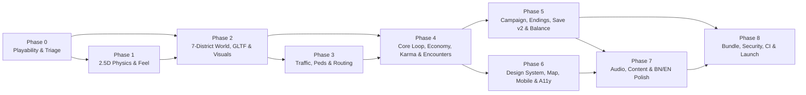

# Uthao Production Overhaul Implementation Plan

> **For agentic workers:** REQUIRED SUB-SKILL: Use superpowers:subagent-driven-development (recommended) or superpowers:executing-plans to implement this plan task-by-task. Steps use checkbox (`- [ ]`) syntax for tracking.

**Goal:** Transform Uthao from its audited `65fb698` prototype state into a fast-loading, polished, culturally authentic, production-ready browser-based 3D Dhaka motorcycle ride-hailing game (playable instantly across desktop, mobile Chrome/Safari, and social in-app browsers like `baperrasta.com`) delivering the complete `docs/MASTER.md` 7-district experience.

**Architecture:**
1. Replace `@dimforge/rapier3d-compat` (4.33 MB inline WASM) with a deterministic, zero-allocation 2.5D spatial-hash swept-capsule/OBB collision engine (`src/physics/PhysicsWorld.ts`) supporting static elevation bands, dynamic traffic OBBs, and fast 2D raycasts.
2. Wire a real external CC0 GLTF + `@gltf-transform` (Meshopt + WebP) asset pipeline (`scripts/fetch-assets.mjs`, `scripts/optimize-assets.mjs`, `src/render/assets.ts`) paired with upgraded Dhaka hero landmarks/vehicles across all 7 uniquely generated districts.
3. Complete `GameSession`, `EconomyManager`, `ReputationSystem` (8 bounded attributed meters), `EventDirector` (police, accidents, robbery, weather, road events), `MissionManager` (Chapters 1–6 + 5 endings), `SaveV2` (Zod-validated), and real-code bot parity.
4. Consolidate UI into a single Preact root with MASTER.md §16 design tokens, reusable accessible components, mobile-web-first non-overlapping landscape touch controls, full BN/EN polish with self-hosted `Hind Siliguri` fonts, sample-backed audio, viral scorecard sharing, stripped production debug surfaces, and CI-gated Playwright tests against built `dist/`.

**Tech Stack:** TypeScript 6, Three.js 0.186 (`GLTFLoader` + `MeshoptDecoder`), Custom 2.5D Swept-Collider Physics, Preact 11 + Signals, Zod 4, `@gltf-transform/{core,cli}`, Vite 8 + lightweight Workbox caching, Vitest 5, Playwright 1.64, Static CDN hosting (Cloudflare Pages / Vercel / Netlify).

**Spec & Baseline:** `docs/MASTER.md` (supersedes `docs/GDD.md`), superseding the unfinished M2–M5 queue of `docs/superpowers/plans/2026-11-02-master-doc-update.md`. Audited baseline: commit `65fb698` (2026-11-19).

---

## Locked Product & Architectural Decisions (Confirmed 2026-11-19)

1. **Physics Engine — Native 2.5D Swept-Collider Engine (Option A):** Drop `@dimforge/rapier3d-compat` completely (~4.33 MB / ~70% JS reduction, instant boot without WASM compilation, physical OBB traffic collisions + push-out, 2.5D elevation bands for Mohakhali Flyover).
2. **3D Art Pipeline — Real External CC0 GLTF + `@gltf-transform` Pipeline (Option B):** Download/verify CC0 Kenney City Kits (Commercial, Suburban, Roads) & Car Kit + UI/Impact audio via `scripts/fetch-assets.mjs`, optimize with Meshopt + WebP (`<= 512px`) via `scripts/optimize-assets.mjs`, load via Three.js `GLTFLoader` + `MeshoptDecoder` in `src/render/assets.ts`, paired with upgraded Dhaka-specific hero models (green CNG, folk-art rickshaw, Dhaka bus, commuter bikes `old100`/`used125`/`new150`, Tong tea stalls, fuel canopies, Kamal's garage shutter, footbridges, rooftop water tanks, overhead wires, Bengali signboards).
3. **World Scope — All 7 Districts Polished (Option A):** Distinct generator topologies and landmark layouts for `mirpara`, `fulgate`, `dhanbagh`, `mohakhal`, `gulbari`, `puranpara`, and `motinagar` with full inter-district connectors and the complete 20-day 6-chapter campaign + 5 endings.
4. **Distribution — Pure Browser-Based Web Game (Benchmark: `baperrasta.com`):** Static CDN web release optimized for instant cold start (`< 2.5s` on 4G), seamless Desktop + Android Chrome + iOS Safari + Facebook/Messenger in-app browser play, Quick Ride (Endless) entry alongside Career, "Skip Tutorial" option, viral Bangla/English shift & ending scorecard share PNGs, OpenGraph social previews, and zero mandatory Play Store / Capacitor wrapper.

---

## Global Constraints

- **Sim Purity:** `src/core/**` and `src/sim/**` remain pure TypeScript (no `three`, `preact`, `window`, `document`, or `Math.random()`). Enforced by `eslint.config.js`.
- **Single-Writer Invariants:** Money mutates only via `EconomyManager`; ride state only via `TripFsm`; reputation/karma meters only via `ReputationSystem.applyMeter()`. UI dispatches commands and never mutates sim objects directly.
- **Hot-Path Allocation Budget:** `PhysicsWorld`, `MotorcycleController.update`, `TrafficManager.update`, and `Renderer.render` remain allocation-free on steady-state frames (`tests/unit/sim/hotPathAllocations.test.ts`).
- **Performance & Size Budgets (Browser-First):**
  - Initial boot JS shell (to Main Menu): `<= 400 KB` gzipped (down from 1.95 MB gz).
  - First playable district total transfer (shell + Mirpara + core GLBs + fonts): `<= 2.5 MB` gzipped; cold boot to interactive canvas `< 2.5s` on Fast 4G.
  - Runtime: `<= 100` draw calls/frame (shadows on), `>= 30 FPS` on mid/low Android mobile browsers, JS heap `< 120 MB` over 20-min play.
- **Localization & Branding:** Zero hardcoded player-facing strings; every key exists in both `data/dialogue/bn/*` and `data/dialogue/en/*`; Bangla title is **`উঠাও`**, English title is **`Uthao`** (never `উধাও`, `UTHÃO`, or `Dhaka Bike Rider`); all numbers formatted via `localDigits()` in `bn` mode; self-hosted `Hind Siliguri` `.woff2`.
- **Visual Tokens (MASTER §16):** Dark slate translucent surfaces, Uthao Green `#22C55E`, Dhaka Amber `#F59E0B`, Danger Red `#EF4444`. Every visible button performs a real action; no fake success.
- **Depiction Rules (MASTER §§4, 11–13):** Respectful everyday Dhaka tone; not every alley dangerous, not every officer corrupt, not every risky passenger criminal; serious injury never trivialized.
- **Production Safety:** Zero `window.__uthao`, `window.__uthaoUi`, `?debug=1`, `?tool=map`, `?encounters=0`, `AutopilotController`, or `testloop.json` in production `dist/`.
- **Verification Loop per Task:** Failing test -> confirm fail -> implement -> `npm run check` + relevant Playwright spec (`desktop-chrome` and `pixel7` for UI/input/render tasks) -> commit.

---

## Review Focus

1. **Clicking or tapping modals in real browsers fails silently or leaks to canvas underneath:** Pinned by `P0.2` & `P6.4` (real pointer-click E2E on `SaveSlots`, `Journal`, `Ending`, and touch-isolation tests proving UI taps do not fire throttle/steer).
2. **Reloading at `DayEnd` (`shiftEnded: true`), mid-trip, mid-settlement, or with corrupt/full `localStorage` softlocks or double-pays:** Pinned by `P5.2` (SaveV2 Zod validation, DayEnd auto-reopen, idempotent settlement, safe quota fallback).
3. **Day-rollover clock reset (`1380 -> 420`) permanently freezes encounters or accident triggers on Day 2+:** Pinned by `P4.4` (`EventDirector.resetDaily()` clears cooldowns/global timer; `GameSession` resets `lastAccidentEncounterMin` on `day/started`).
4. **Crossing district borders or driving straight through divided arterials causes invisible roads, zero traffic in Gulbari, or phantom U-turn penalties:** Pinned by `P2.1` & `P3.1` (0 zero-length connectors, 100% rendered connectors, 0 building overlaps, straight arterial routing `uTurns === 0`).
5. **Mobile in-app browsers (Facebook/Messenger/iOS Safari/Android Chrome) stall on load, clip CTAs at `390–412px` height, break safe areas, or stay silent on audio:** Pinned by `P0.3`, `P6.4`, `P7.1`, `P8.2` (`100dvh`, `viewport-fit=cover`, scrollable modals, robust audio resume on gesture + `visibilitychange`, instant shell boot).

---

## Baseline Audit Summary (Commit `65fb698`)

| Verified Defect Cluster | Owning Task(s) |
|---|---|
| Inverted human steering (`KeyA` turns right) + inverted camera roll | `P0.1` |
| Unclickable `SaveSlots`/`Ending`/`Journal` + pass-through overlays + Z-index inversions + `exitToTitle()` modal leaks + Preact Hooks violations | `P0.2` |
| Boot race before `bindUi()` + WebGL2 fallback doesn't abort + `#boot-text` / dead `<Loading />` + failing E2E (`dayEnd`, `negotiation`, `input`) | `P0.3` |
| `উধাও` ("Vanish"), `社区` Chinese chars, `UTHÃO`, `কমল`, false Audio prototype note, AI dev credits | `P0.4` |
| 4.33 MB Rapier inline WASM + 519 wasted `raw.step()` calls on boot | `P1.1` |
| Ice coasting, parallel-scrape crash bug, 9.2m circular bus hitboxes, head-on `0 km/h`, 60Hz near-miss spam, median recovery loop, unwired bike/upgrade physics | `P1.2`, `P1.3` |
| 7 cloned grids, 43% buildings overlapping roads & rotated 90° wrong, 4m arterial overlap, 0m E–W connectors, unrendered 160m N–S connectors, flat Mohakhali flyover, 0 `market` roads, 2 invisible signals | `P2.1`, `P2.3` |
| No-op `fetch-assets.mjs`/`optimize-assets.mjs` & unused `AssetManager`/Dhaka props | `P2.2`, `P2.3`, `P2.4` |
| Invisible shadows (origin `±50m`), dark daylight, 0 streetlights, broken camera anti-clip (`matrixWorld` identity), `unloadDistrict()` shared-material corruption & 504 `BatchedMesh` texture leaks, `webglcontextrestored` collider duplication, 191+ draw calls | `P2.5`, `P2.6` |
| Phantom `+25s` straight-arterial U-turns, 1 nearby rush-hour car, oncoming head-on acceleration, horn freezing traffic/peds, bus teleport-fusing, moonwalking peds | `P3.1`, `P3.2` |
| Street-hail 15% commission, off-app RNG fork bug, dead `passenger/dialogue`, `explainDetour` exploit, `savings=0`/`debt` unrepayable, 48-min shifts, disconnected `garageSignal`, unwired `DeliveryManager` | `P4.1`, `P4.2` |
| Missing 5/8 karma meters & log, unseeded `initialRelationship`, 7 dead encounters (missing context), day-rollover encounter lock, inert `RoadEventManager` & `WeatherSystem`, paper-thin police/accidents/robbery | `P4.3`, `P4.4`, `P4.5` |
| 7 hard campaign softlocks (Ch3–Ch6 & all 5 endings unreachable), `MissionManager` lost on load, `day/ended` reload softlock, fake parallel bot harness | `P5.1`, `P5.2`, `P5.3` |
| Inline-styled dual-root UI, missing Karma/UI Sheet panels, Mirpara-only Map, clipped mobile modals, overlapping `TouchActions`/HUD, 12/13 modals missing focus traps & ARIA | `P6.1`–`P6.5` |
| Raw oscillator/noise audio leaking on menus, hardcoded EN/BN leaks, `localDigits` unused, offline Google Fonts failure, thin T8.6 dialogues, emoji portraits | `P7.1`–`P7.3` |
| Prod debug API leaks (`__uthaoUi`, `?debug=1`, `testloop`), no error boundary, broken PWA icons/manifest, missing LICENSE/Privacy/OG/CDN config, CI missing E2E | `P8.1`–`P8.4` |

---

## Architecture & Phase Map



---

## Phase 0: Emergency Playability & Structural Triage

### Task P0.1: Fix Inverted Human Steering & Camera Lean Roll

**Files:**
- Modify: `src/input/types.ts`, `src/input/InputManager.ts:95-150,310-346`, `src/physics/bikeModel.ts:130-165`, `src/debug/autopilot.ts:105-115`, `src/sim/road/navigation.ts:55-68`, `src/render/CameraRig.ts:145-155`, `src/main.ts:368-374`
- Test: `tests/unit/input/InputManager.test.ts`, `tests/unit/physics/bikeModel.test.ts`, `tests/e2e/input.spec.ts`

**Interfaces:**
- Canonical sign rule in `src/input/types.ts` and `src/physics/bikeModel.ts`: `steer = -1` means turn **left** (screen-left in chase cam); `steer = +1` means turn **right** (screen-right in chase cam). `lean > 0` leans right; `lean < 0` leans left.

- [ ] **Step 1: Write the failing test**

```ts
// tests/unit/physics/bikeModel.test.ts
it('steer = -1 turns screen-left and steer = +1 turns screen-right in Three.js chase camera', () => {
  const cam = new THREE.PerspectiveCamera(60, 16 / 9, 0.1, 200);
  cam.position.set(0, 3, -5);
  cam.lookAt(0, 1, 2);
  cam.updateMatrixWorld();

  let leftState = createDefaultBikeState();
  leftState.speed = 10;
  for (let i = 0; i < 30; i++) leftState = stepBike(leftState, { throttle: 0.5, brake: 0, steer: -1 }, spec, dryEnv, 1 / 60);
  const ndcLeft = new THREE.Vector3(leftState.x, 0, leftState.z).project(cam);
  expect(ndcLeft.x).toBeLessThan(-0.05);
});
```

- [ ] **Step 2: Run test to verify it fails**

Run: `npx vitest run tests/unit/physics/bikeModel.test.ts -t "turns screen-left"`
Expected: FAIL (`ndcLeft.x > 0`, moves screen-right).

- [ ] **Step 3: Implement unified steering and banking camera roll**
  - In `src/physics/bikeModel.ts:131-160`, negate `rawYawRate = -(newSpeed * Math.tan(newSteer)) / WHEELBASE` (or flip `targetSteerRad` sign) so `steer = -1` turns toward `+X` (screen-left when facing `+Z`). Update `src/debug/autopilot.ts` and `src/sim/road/navigation.ts` to emit `-1 = left, +1 = right` consistently.
  - In `src/render/CameraRig.ts:146-150`, align `camera.rotateZ(roll)` with `MotorcycleMesh.setPose` lean direction so banking right rolls the horizon clockwise into the turn.
  - Assert `InputManager` outputs `-1` for `KeyA`/`ArrowLeft`/left touch drag/left stick X and `+1` for right across all input devices.

- [ ] **Step 4: Run tests to verify pass**

Run: `npx vitest run tests/unit/physics/bikeModel.test.ts tests/unit/input/InputManager.test.ts tests/unit/sim/autopilot.test.ts tests/unit/sim/navigation.test.ts`
Expected: PASS across all 4 files.

- [ ] **Step 5: Commit**

```bash
git add src/input/ src/physics/bikeModel.ts src/debug/autopilot.ts src/sim/road/navigation.ts src/render/CameraRig.ts src/main.ts tests/unit/physics/bikeModel.test.ts
git commit -m "fix(P0.1): align steering and camera roll so left turns screen-left"
```

---

### Task P0.2: Fix Unclickable Modals, Z-Index Layering, Modal Lifecycle & Preact Hooks

**Files:**
- Modify: `src/ui/store.ts:345-356`, `src/ui/App.tsx:73-508`, `src/ui/menus/{SaveSlots,Ending,MainMenu,Settings}.tsx`, `src/ui/journal/Journal.tsx:37-50`, `src/ui/overlays/{Loading,RotateOverlay,Unsupported}.tsx`, `src/ui/map/MapScreen.tsx:25-80`
- Test: `tests/unit/ui/exitToTitle.test.ts`, `tests/e2e/menus.spec.ts`

**Interfaces:**
- Produces `export const Z_LAYER = { HUD: 100, TOUCH: 200, TOAST: 300, PANEL: 500, MODAL: 700, CRITICAL_MODAL: 800, SYSTEM_OVERLAY: 900 } as const;` in `src/ui/store.ts`.
- `exitToTitle(): void` clears `tutorialSignal`, `pausedSignal`, `phoneSignal` (`open: false`), `negotiationSignal`, `garageSignal` (`open: false`), `journalSignal`, `dayEndSignal`, `endingSignal`, `tripSummarySignal`, `choiceSignal`, `saveSlotsSignal`.

- [ ] **Step 1: Write failing unit & E2E tests**

```ts
// tests/unit/ui/exitToTitle.test.ts
it('clears all open modal and panel signals when returning to title', () => {
  phoneSignal.value = { ...phoneSignal.value, open: true };
  garageSignal.value = { ...garageSignal.value, open: true };
  journalSignal.value = true;
  saveSlotsSignal.value = { isOpen: true, mode: 'save' };
  exitToTitle();
  expect(phoneSignal.value.open).toBe(false);
  expect(garageSignal.value.open).toBe(false);
  expect(journalSignal.value).toBe(false);
  expect(saveSlotsSignal.value.isOpen).toBe(false);
});
```
Add a Playwright test in `tests/e2e/menus.spec.ts` opening Pause -> Save Slots and clicking the Close button with a real pointer click (no `force: true`), and verifying `Ending` and `Journal` close buttons respond to real clicks.

- [ ] **Step 2: Run tests to verify they fail**

Run: `npx vitest run tests/unit/ui/exitToTitle.test.ts && npx playwright test tests/e2e/menus.spec.ts --project=desktop-chrome`
Expected: FAIL (`phoneSignal.value.open` stays `true`; pointer click on `SaveSlots` hits canvas behind `#uthao-app-root`).

- [ ] **Step 3: Implement modal interactivity, Z-layers, Escape/hotkey guards, and Hook fixes**
  - Add `pointerEvents: 'auto'` to root containers of `SaveSlots.tsx`, `Ending.tsx`, `Journal.tsx`, `Loading.tsx`, `RotateOverlay.tsx`, `Unsupported.tsx`, and `App.tsx`'s `context-lost-overlay`.
  - Apply `Z_LAYER` ordering in `App.tsx` and reorder JSX so System Overlays (`Unsupported`, `RotateOverlay`, `ContextLost`, `Loading`) render after all modals.
  - Guard `G`/`J`/`N` hotkeys in `App.tsx:111-127` with `screenSignal.value === 'game' && !uiModalOpen(...)`.
  - Add an `onCancel` ref/prop to `Settings` so pressing `Escape` in `App.tsx:130` restores previewed language before closing.
  - Move all `useState`/`useRef`/`useEffect` calls above early returns and outside `try/catch` in `MainMenu.tsx`, `Settings.tsx`, and `MapScreen.tsx`.

- [ ] **Step 4: Run tests to verify they pass**

Run: `npx vitest run tests/unit/ui/exitToTitle.test.ts && npx playwright test tests/e2e/menus.spec.ts --project=desktop-chrome`
Expected: PASS.

- [ ] **Step 5: Commit**

```bash
git add src/ui/ tests/unit/ui/exitToTitle.test.ts tests/e2e/menus.spec.ts
git commit -m "fix(P0.2): restore modal pointer events, z-index hierarchy, hotkey guards, and hook rules"
```

---

### Task P0.3: Fix Boot Race Condition, WebGL2 Abort & Failing Playwright E2E Specs

**Files:**
- Modify: `src/ui/store.ts:151`, `src/ui/overlays/Loading.tsx`, `src/main.ts:110-315`, `tests/e2e/{dayEnd,negotiation,input}.spec.ts`
- Test: `tests/e2e/boot.spec.ts`, `tests/e2e/dayEnd.spec.ts`, `tests/e2e/negotiation.spec.ts`, `tests/e2e/input.spec.ts`

**Interfaces:**
- Update `loadingSignal` in `src/ui/store.ts` to `signal<{ active: boolean; stageKey: string; progress: number }>({ active: true, stageKey: 'loading.boot', progress: 0 })` (with `?debug=1` or headless unit safety).

- [ ] **Step 1: Write failing test for boot readiness & WebGL2 early abort**

Add test in `tests/e2e/boot.spec.ts` checking that when `#main-menu` becomes visible, `[data-testid="menu-new-career"]` responds immediately on the first click without a null callback race.

- [ ] **Step 2: Run failing tests**

Run: `npx playwright test tests/e2e/dayEnd.spec.ts tests/e2e/negotiation.spec.ts tests/e2e/input.spec.ts --project=desktop-chrome`
Expected: FAIL on `dayEnd.spec.ts` & `negotiation.spec.ts`.

- [ ] **Step 3: Fix boot sequence, error catching, WebGL2 abort, and E2E specs**
  - In `src/main.ts:113-275`: keep `loadingSignal` active until `PhysicsWorld.create()`, `Renderer.init()`, `loadRendererScene()`, `SaveSystem`, and `bindUi()` complete; only then hide `<Loading />` and show `<MainMenu />`. Wrap `bootGame()` with `.catch(...)` setting an explicit error state instead of silent `void bootGame()`.
  - If `!hasWebGL2Support()`, pass `t('ui.unsupported_webgl')` to `unsupportedSignal.value`, clear `loadingSignal`, and `return` immediately before allocating physics/renderer/rAF loop.
  - Fix `tests/e2e/dayEnd.spec.ts` (`?debug=1&district=testloop&encounters=0`, dismiss `TripSummary`, 120s timeout for SwiftShader), `tests/e2e/negotiation.spec.ts` (`&encounters=0`, 120s timeout), and `tests/e2e/input.spec.ts` (retry `BTN_A` press across SwiftShader frame gaps, 60s timeout).

- [ ] **Step 4: Run full `desktop-chrome` Playwright suite**

Run: `npx playwright test --project=desktop-chrome`
Expected: 0 failed.

- [ ] **Step 5: Commit**

```bash
git add src/main.ts src/ui/store.ts src/ui/overlays/Loading.tsx tests/e2e/
git commit -m "fix(P0.3): eliminate boot callback race, abort on missing WebGL2, and stabilize e2e"
```

---

### Task P0.4: Brand, Copy & Embarrassment Hotfixes

**Files:**
- Modify: `data/dialogue/bn/ui.json`, `data/dialogue/en/ui.json`, `src/ui/journal/Journal.tsx:342`, `scripts/gen-district.ts:581`, `src/ui/menus/Settings.tsx:362-364`, `src/ui/menus/MainMenu.tsx:194-210,361-396`, `index.html:15`, `vite.config.ts:11`
- Test: `tests/unit/ui/i18nKeyCoverage.test.ts`

- [ ] **Step 1: Write failing regression test**

```ts
// tests/unit/ui/i18nKeyCoverage.test.ts
it('uses উঠাও / Uthao consistently and contains zero CJK characters in UI or dialogue', () => {
  expect(bnUi['menu.title']).toBe('উঠাও');
  expect(enUi['menu.title']).toBe('UTHAO');
  // Scan data/dialogue/{bn,en}/*.json and src/ui/**/*.tsx for [\u4e00-\u9fff]
  expect(findCjkMatches()).toEqual([]);
});
```

- [ ] **Step 2: Run test to verify it fails**

Run: `npx vitest run tests/unit/ui/i18nKeyCoverage.test.ts`
Expected: FAIL (`উধাও`, `UTHÃO`, `社区`).

- [ ] **Step 3: Apply brand & copy fixes**
  - Fix `bn/ui.json` (`উধাও` / `উথাও` -> `উঠাও`, `কমল` -> `কামাল`) and `en/ui.json` (`UTHÃO` -> `UTHAO`).
  - Fix `Journal.tsx:342` (`社区বিশ্বাস` -> `সামাজিক বিশ্বাস`).
  - Fix `scripts/gen-district.ts:581` (`ফার্মগেট` -> `ফুলগেট`).
  - Update `index.html:15` (`<title>Uthao</title>`) and `vite.config.ts:11` (`name: 'Uthao'`).
  - Remove false `settings.prototype_note` from Audio tab in `Settings.tsx:362-364`.
  - Style `MainMenu` New Career confirm buttons properly and replace internal AI team / non-existent asset claims in `MainMenu.tsx` Credits with truthful provisional copy.

- [ ] **Step 4: Run `npm run check`**

Run: `npm run check`
Expected: PASS.

- [ ] **Step 5: Commit**

```bash
git add data/dialogue/ src/ui/ scripts/gen-district.ts index.html vite.config.ts tests/unit/ui/i18nKeyCoverage.test.ts
git commit -m "fix(P0.4): correct Uthao branding, remove CJK typo, and clean up misleading UI notes"
```

**Phase 0 Exit Gate:** `npm run check && npx playwright test --project=desktop-chrome` passes 100% with accurate steering, clickable modals, race-free boot, and clean titles.

---

## Phase 1: Native 2.5D Swept-Collider Physics Engine & Bike Feel

### Task P1.1: Replace Rapier WASM with Deterministic Spatial-Hash 2.5D `PhysicsWorld`

**Files:**
- Rewrite: `src/physics/PhysicsWorld.ts`
- Modify: `src/physics/MotorcycleController.ts`, `src/render/CityBuilder.ts`, `src/main.ts`, `package.json`, `vite.config.ts`, `eslint.config.js`
- Create: `tests/unit/physics/PhysicsWorld.test.ts`
- Test: `tests/unit/sim/hotPathAllocations.test.ts`, `tests/unit/physics/MotorcycleController.test.ts`

**Interfaces:**
```ts
export type StaticColliderKind = 'building' | 'kerb' | 'median' | 'prop';
export interface StaticBoxHandle {
  readonly id: number;
  readonly kind: StaticColliderKind;
  readonly x: number;
  readonly z: number;
  readonly halfX: number;
  readonly halfZ: number;
  readonly minY: number;
  readonly maxY: number;
  readonly yaw: number;
  readonly cos: number;
  readonly sin: number;
}
export interface DynamicObb {
  id: string;
  kind: string;
  x: number;
  z: number;
  halfX: number;
  halfZ: number;
  minY: number;
  maxY: number;
  yaw: number;
  vx: number;
  vz: number;
}
export interface SweepHit {
  hit: boolean;
  toi: number;
  normalX: number;
  normalZ: number;
  otherKind: StaticColliderKind | 'traffic';
  otherId?: string;
  otherVx: number;
  otherVz: number;
}
export class PhysicsWorld {
  static create(): Promise<PhysicsWorld>;
  addStaticBox(x: number, y: number, z: number, halfX: number, halfY: number, halfZ: number, yaw?: number, kind?: StaticColliderKind): StaticBoxHandle;
  removeCollider(handle: StaticBoxHandle): void;
  clearDynamicVehicles(): void;
  upsertDynamicVehicle(obb: DynamicObb): void;
  sweepCapsule(x: number, z: number, y: number, radius: number, dx: number, dz: number, out: SweepHit, slideOut: { x: number; z: number }): void;
  castRay2D(ox: number, oz: number, y: number, dirX: number, dirZ: number, maxDist: number, filterKinds?: readonly StaticColliderKind[]): number | null;
  queryAabb(minX: number, minZ: number, maxX: number, maxZ: number, out: StaticBoxHandle[]): void;
}
```

- [ ] **Step 1: Write failing unit tests for `PhysicsWorld` and allocation budget**

```ts
// tests/unit/physics/PhysicsWorld.test.ts
it('resolves rotated OBB sweep, sliding along angled walls without penetrating', () => {
  const pw = await PhysicsWorld.create();
  pw.addStaticBox(10, 1, 0, 2, 1, 5, Math.PI / 4, 'building');
  const hit: SweepHit = { hit: false, toi: 1, normalX: 0, normalZ: 0, otherKind: 'building', otherVx: 0, otherVz: 0 };
  const slide = { x: 0, z: 0 };
  pw.sweepCapsule(7.5, 0, 0.5, 0.35, 3, 0, hit, slide);
  expect(hit.hit).toBe(true);
  expect(hit.toi).toBeLessThan(1);
  expect(Math.hypot(slide.x, slide.z)).toBeGreaterThan(0);
});

it('isolates elevation bands so flyover colliders do not block ground vehicles', () => {
  const pw = await PhysicsWorld.create();
  pw.addStaticBox(0, 6, 0, 5, 0.5, 2, 0, 'kerb'); // flyover at y=6
  const hit: SweepHit = { hit: false, toi: 1, normalX: 0, normalZ: 0, otherKind: 'building', otherVx: 0, otherVz: 0 };
  const slide = { x: 0, z: 0 };
  pw.sweepCapsule(0, -3, 0.5, 0.35, 0, 6, hit, slide);
  expect(hit.hit).toBe(false);
});
```

- [ ] **Step 2: Run test to verify it fails**

Run: `npx vitest run tests/unit/physics/PhysicsWorld.test.ts`
Expected: FAIL (missing `kind`, `sweepCapsule`, `castRay2D`).

- [ ] **Step 3: Implement spatial-hash `PhysicsWorld` and remove `@dimforge/rapier3d-compat`**
  - Implement 20m spatial grid (`Map<number, StaticBoxHandle[]>` keyed by `(cx << 16) ^ (cz & 0xffff)` or packed bigint/float key), OBB local-space transform for circle-vs-OBB sweep + 2-pass wall slide, elevation overlap filter (`y + 1.5 >= minY && y <= maxY`), zero-allocation scratch arrays.
  - Update `MotorcycleController` to use `sweepCapsule` and `castRay2D` (zero Rapier imports).
  - Pass explicit `kind` (`'building' | 'kerb' | 'median'`) from `CityBuilder.ts`.
  - Remove `@dimforge/rapier3d-compat` from `package.json`, remove `vendor-rapier` chunk & set `chunkSizeWarningLimit: 700` and `maximumFileSizeToCacheInBytes: 3 * 1024 * 1024` in `vite.config.ts`, update `eslint.config.js` comments.

- [ ] **Step 4: Run tests and verify bundle size reduction**

Run: `npm run check && npm run build && ls -lh dist/assets/`
Expected: PASS; `dist/assets/` contains zero `vendor-rapier*` files and total JS size `< 1.6 MB` raw.

- [ ] **Step 5: Commit**

```bash
git add src/physics/ src/render/CityBuilder.ts src/main.ts package.json package-lock.json vite.config.ts eslint.config.js tests/unit/physics/
git commit -m "perf(P1.1): replace 4.3MB Rapier WASM with deterministic 2.5D spatial-hash swept physics"
```

---

### Task P1.2: Upgrade `MotorcycleController` & `bikeModel` (Gearbox, Grip, OBB Traffic Collisions)

**Files:**
- Modify: `src/physics/bikeModel.ts`, `src/physics/MotorcycleController.ts`, `src/sim/GameSession.ts:380-495`
- Test: `tests/unit/physics/{bikeModel,MotorcycleController,reverse}.test.ts`, `tests/unit/sim/trafficContactOnce.test.ts`

**Interfaces:**
- `BikeState` adds `gear: 1 | 2 | 3 | 4 | 5; rpmNorm: number; y: number;` (default `gear: 1, rpmNorm: 0.15, y: 0`).
- `BikeEnvironment` adds `floodSpeedCapMs?: number;`.

- [ ] **Step 1: Write failing physics & collision tests**

```ts
// tests/unit/physics/MotorcycleController.test.ts
it('classifies parallel wall scraping as scuff, never crash', () => {
  // Place building wall at x=2, drive parallel along +Z at 30 km/h with slight drift toward wall
  // Assert severity === 'scuff' and speed stays > 6 m/s
});

it('head-on collision with oncoming traffic computes summed vector speed and pushes bike out', () => {
  // Bike at +40 km/h heading +Z; bus OBB at -40 km/h heading -Z directly ahead
  // Assert bike/collision severity === 'crash', relSpeedKmh >= 75, and bike does not overlap bus center
});
```
Also test in `bikeModel.test.ts`: gear shifts `1 -> 5` cleanly across acceleration, coasting decelerates at `~2.0 m/s²`, reversing smoothly decelerates when brake is released (no 1-frame snap to 0), and `floodSpeedCapMs` caps speed.

- [ ] **Step 2: Run tests to verify failure**

Run: `npx vitest run tests/unit/physics/ tests/unit/sim/trafficContactOnce.test.ts`
Expected: FAIL.

- [ ] **Step 3: Implement physics & traffic OBB collision fixes**
  - In `bikeModel.ts`: speed-dependent torque curve; 5-speed automatic shift schedule + `rpmNorm`; `COAST_DECEL = 2.0`; ignore brake noise `< 0.05` so slight trigger drift doesn't kill throttle; reverse requires `|speed| < 0.15` + brake hold `0.25s`, and decelerates smoothly on brake release; unify wet grip (remove redundant double multiplication with `env.surface` or calibrate `wetLateralGrip` + `WeatherSystem` together); clamp speed by `env.floodSpeedCapMs`.
  - In `MotorcycleController.ts`: never upgrade `normalImpact <= 0` grazing scrapes to `totalSpeedKmh` crash; fix `_leftDir`/`_rightDir` perpendiculars and ray height `0.25m`, subtracting `0.35m` capsule radius; feed dynamic traffic OBBs near the bike (`<= 80m`) from `GameSession` into `PhysicsWorld.upsertDynamicVehicle()`, compute vector relative velocity `Math.hypot(bikeVx - hit.otherVx, bikeVz - hit.otherVz) * 3.6`, enforce physical push-out so the bike never phases through vehicles, and share `NEAR_MISS_COOLDOWN_S = 1.0` across static and traffic near-misses.

- [ ] **Step 4: Run tests**

Run: `npx vitest run tests/unit/physics/ tests/unit/sim/trafficContactOnce.test.ts tests/unit/sim/gameSession.test.ts`
Expected: PASS.

- [ ] **Step 5: Commit**

```bash
git add src/physics/ src/sim/GameSession.ts tests/unit/physics/ tests/unit/sim/trafficContactOnce.test.ts
git commit -m "feat(P1.2): add gearbox, realistic coast/reverse, physical traffic OBB collisions, and near-miss cooldown"
```

---

### Task P1.3: Wire Live Bike Specs, Mechanical Upgrades, Safe Recovery & Impact Juice

**Files:**
- Modify: `src/sim/GameSession.ts`, `src/sim/economy/{bikes,maintenance}.ts`, `src/sim/ride/RideManager.ts`, `src/sim/GameManager.ts`, `src/core/commands.ts`, `src/render/CameraRig.ts`, `src/main.ts`
- Test: `tests/unit/sim/{bikes,bikeRecovery,garage}.test.ts`

**Interfaces:**
- `GameSession.syncBikeSpec(): void` (rebuilds `this.bikeSpec` from `getBikeDef(currentBikeId)` + `ownedUpgrades` and pushes to `controller?.setSpec`, `ride.hasEngineTune`, and `economyManager`).
- Command `{ type: 'recoverBike' }` handled by `GameManager` / `GameSession.requestManualRecovery(): boolean`.

- [ ] **Step 1: Write failing tests**

```ts
// tests/unit/sim/bikes.test.ts
it('buying used125 and disc_brakes updates live GameSession bikeSpec, tankCapacityL, and braking distance', () => {
  const s = makeSessionWithCash(50000);
  const dryStopOld = measureStoppingDistance(s);
  s.gm.dispatch({ type: 'buyBike', bikeId: 'used125', useTradeIn: false });
  s.gm.dispatch({ type: 'switchBike', bikeId: 'used125' });
  s.gm.dispatch({ type: 'buyUpgrade', upgradeId: 'upgrade_disc_brakes' });
  expect(s.bikeSpec.vmax).toBe(25);
  expect(s.gm.economyManager.maxFuelL()).toBe(10);
  expect(measureStoppingDistance(s)).toBeLessThan(dryStopOld);
});
```
Add test in `bikeRecovery.test.ts` asserting recovery on a `divided: true` arterial places the bike inside the nearest clear carriageway lane (never on a median collider) and does not re-wedge.

- [ ] **Step 2: Run tests to verify failure**

Run: `npx vitest run tests/unit/sim/bikes.test.ts tests/unit/sim/bikeRecovery.test.ts`
Expected: FAIL.

- [ ] **Step 3: Wire specs, dynamic tank sizes, safe recovery & camera impact juice**
  - Call `syncBikeSpec()` on boot, `bike/swapped`, `upgrade/purchased`, and `applySnapshot()`. Wire `upgrade_disc_brakes`, `upgrade_good_tires` (`effectiveWetGrip` + `checkPuncture` risk reduction), `upgrade_engine_tune` (`ride.hasEngineTune = true`), and `upgrade_phone_mount` (`batteryDrainReduction: 0.5`).
  - Replace hardcoded `BALANCE.FUEL.tankL` across `EconomyManager.ts`, `bindings.ts`, and `main.ts` with `economyManager.maxFuelL()` (`8/10/12L` per `bikes.json`).
  - Update `placeOnRoadNear()` / `recoverBike()` to offset to a clear lane when `divided === true` and support manual `{ type: 'recoverBike' }` recovery.
  - Update `CameraRig.ts` to apply shake along camera-local right/up axes on `crash`, `bump`, `wobble`, and speed bumps.

- [ ] **Step 4: Run `npm run check`**

Run: `npm run check`
Expected: PASS.

- [ ] **Step 5: Commit**

```bash
git add src/sim/ src/core/commands.ts src/render/CameraRig.ts src/main.ts src/ui/bindings.ts tests/unit/sim/
git commit -m "feat(P1.3): wire bike/upgrade physics, per-bike tank capacity, lane recovery, and camera impact juice"
```

**Phase 1 Exit Gate:** `@dimforge/rapier3d-compat` completely removed; `dist/` JS `< 1.6 MB` raw; unit tests prove bike/upgrade stats affect live physics and head-on OBB crashes resolve physically without wedging loops.

---

## Phase 2: 7-District World Topology, Real CC0 GLTF Pipeline & 3D Visual Overhaul

### Task P2.1: Redesign All 7 District Generators, Connectors & Elevated Mohakhali Flyover

**Files:**
- Modify: `scripts/gen-district.ts`, `src/core/types.ts` (optional `y?: number` on `RoadNode`), `src/sim/schemas.ts`, `scripts/validate-data.mjs`
- Regenerate: `data/world.json`, `data/districts/{mirpara,fulgate,dhanbagh,mohakhal,gulbari,puranpara,motinagar}.json`
- Test: `tests/unit/sim/{districtGenerator,districts}.test.ts`

**Interfaces:**
- `RoadNode` gains optional `y?: number` (defaults to `0`). `RoadSegment` keeps all §5 fields plus valid geometry guarantees.

- [ ] **Step 1: Write failing geometric & topology tests**

```ts
// tests/unit/sim/districts.test.ts
it('zero building lots overlap any road or sidewalk polygon across all 7 districts', () => { ... });
it('has zero zero-length segments or connectors, >= 12 signaled junctions, and real market segments', () => { ... });
it('each district has distinct street density/topology and Mohakhali flyover rises to y >= 5.5m', () => { ... });
```

- [ ] **Step 2: Run tests to verify failure**

Run: `npx vitest run tests/unit/sim/districts.test.ts tests/unit/sim/districtGenerator.test.ts`
Expected: FAIL (43% building overlap, 8 zero-length E–W connectors, 0 market roads, 2 signals, flat flyover `y=0`).

- [ ] **Step 3: Overhaul `gen-district.ts`, regenerate all 7 districts & `world.json`, enforce in `validate-data.mjs`**
  - Make `DistrictStyle` (`blockM`, `alleyDensity`, `marketStreets`, `organic`, `demandZones`, `arterial`) drive distinct layouts across all 7 districts (`mirpara`, `fulgate`, `dhanbagh`, `mohakhal`, `gulbari`, `puranpara`, `motinagar`), with `puranpara` genuinely dense/narrow/alley-rich rather than an 8-lane divided clone.
  - Separate divided arterial carriageways `art_n`/`art_s` by `>= width + 3.0m` (no 4m self-overlap), remove central medians from one-way carriageways, add `roadType: 'market'` streets in Mirpara, Fulgate, Puran Para, and Motinagar, and place `signal: true` at major intersections across all 7 districts (`>= 12`).
  - Elevate Mohakhali Flyover deck nodes (`y = 6.0`) with sloped ramps (`y = 0 -> 6.0`), spaced cleanly from ground arterial lanes.
  - Replace zero-length E–W connectors with real `20–30m` bridge connectors (re-centering internal district edge nodes by `10–15m` inward) so every connector has `len >= 20m`.
  - Generate varied continuous building lots (`width: 10–22m, depth: 10–16m`) on both sides of streets `>= 35m`, offset by `seg.width / 2 + sidewalkW + lot.depth / 2 + 1.5m`, skipping U-turn/crossing links. Add automated OBB-vs-road/sidewalk intersection validation in `scripts/validate-data.mjs`.

- [ ] **Step 4: Regenerate data and run tests**

Run: `npx tsx scripts/gen-district.ts && npm run check`
Expected: `validate-data.mjs` and all district/routing tests PASS with 0 overlaps.

- [ ] **Step 5: Commit**

```bash
git add scripts/gen-district.ts scripts/validate-data.mjs src/core/types.ts src/sim/schemas.ts data/world.json data/districts/ tests/unit/sim/
git commit -m "feat(P2.1): overhaul 7-district topology, fix arterial/building overlaps, add elevated flyover and connectors"
```

---

### Task P2.2: Build Real External CC0 GLTF + `@gltf-transform` Asset Pipeline

**Files:**
- Modify: `assets.manifest.json`, `scripts/fetch-assets.mjs`, `scripts/optimize-assets.mjs`, `src/render/assets.ts`, `docs/ASSETS.md`, `package.json`
- Add: `public/assets/models/*.glb` (optimized GLTF assets generated by pipeline)
- Test: `tests/unit/render/assets.test.ts`

**Interfaces:**
```ts
export interface AssetCatalogEntry {
  id: string;
  url: string;
  pack: string;
  license: 'CC0-1.0';
  category: 'building' | 'vehicle' | 'prop' | 'audio';
  scale?: number;
}
export class AssetManager {
  init(renderer?: THREE.WebGLRenderer): Promise<void>; // registers GLTFLoader + MeshoptDecoder
  preloadCore(onProgress?: (pct: number) => void): Promise<void>;
  loadModel(id: string, lod?: 'high' | 'low'): Promise<THREE.Object3D>;
  getInstancedPrototype(id: string): { geometry: THREE.BufferGeometry; material: THREE.Material | THREE.Material[] } | null;
  dispose(): void;
}
```

- [ ] **Step 1: Write failing asset pipeline & loader tests**

```ts
// tests/unit/render/assets.test.ts
it('manifest references existing optimized GLBs in public/assets/models under 2MB total', () => {
  // Check every model entry in assets.manifest.json resolves to an actual .glb file on disk
});
it('AssetManager wires GLTFLoader + MeshoptDecoder and falls back cleanly in headless Node', async () => { ... });
```

- [ ] **Step 2: Run test to verify failure**

Run: `npx vitest run tests/unit/render/assets.test.ts`
Expected: FAIL (`public/assets/models/*.glb` does not exist; `AssetManager` has no `init`/`preloadCore`/`GLTFLoader`).

- [ ] **Step 3: Implement `fetch-assets.mjs`, `optimize-assets.mjs`, and `AssetManager`**
  - Update `assets.manifest.json` with verified CC0 Kenney download URLs, target model/audio filenames, and SHA-256 verification.
  - Implement `scripts/fetch-assets.mjs` to download CC0 Kenney archives into `assets-src/`, verify CC0 license files, extract curated `.glb` models (commercial storefronts, suburban homes, road props, cars/vans/trucks) and `.ogg` audio packs.
  - Implement `scripts/optimize-assets.mjs` using `@gltf-transform/core` (`dedup`, `prune`, `flatten`, `quantize`, `meshopt`, texture resize `<= 512px` WebP) outputting compact `.glb` files into `public/assets/models/`, enforcing `< 1.2 MB` gz total model catalog.
  - Update `src/render/assets.ts` to use `GLTFLoader` + `MeshoptDecoder` (`three/examples/jsm/loaders/GLTFLoader.js`, `three/examples/jsm/libs/meshopt_decoder.module.js`), normalize ground pivots (`minY = 0`), extract geometry/material prototypes for `InstancedMesh`, and retain graceful procedural fallback for Node tests or offline failures.

- [ ] **Step 4: Run `npm run assets && npm run check`**

Run: `npm run assets && npm run check`
Expected: Optimized `.glb` files created in `public/assets/models/`; tests PASS.

- [ ] **Step 5: Commit**

```bash
git add assets.manifest.json scripts/fetch-assets.mjs scripts/optimize-assets.mjs src/render/assets.ts public/assets/ docs/ASSETS.md tests/unit/render/assets.test.ts
git commit -m "feat(P2.2): implement real CC0 Kenney GLTF fetch, Meshopt/WebP optimization, and GLTFLoader"
```

---

### Task P2.3: Overhaul Road Meshes, Buildings, Landmarks, Signage & Connectors

**Files:**
- Modify: `src/render/roadMesh.ts`, `src/render/buildings.ts`, `src/render/props.ts`, `src/render/CityBuilder.ts`, `src/render/textures.ts`, `src/render/signage.ts`
- Test: `tests/unit/render/{roadMesh,cityBuilder,signage}.test.ts`

- [ ] **Step 1: Write failing render-geometry tests**

```ts
// tests/unit/render/roadMesh.test.ts & cityBuilder.test.ts
it('getRoadWidth honors segment.width across alleys, residential, and wide boulevards', () => { ... });
it('builds road meshes and colliders for world.connectors and elevated flyover decks with pillars', () => { ... });
it('orients building facades toward the street (+Z/-Z local facing normal points toward nearest road)', () => { ... });
it('places 3D POI props (teaStall, fuel, garage, footbridge, traffic signals) in district chunks', () => { ... });
```

- [ ] **Step 2: Run tests to verify failure**

Run: `npx vitest run tests/unit/render/roadMesh.test.ts tests/unit/render/cityBuilder.test.ts tests/unit/render/signage.test.ts`
Expected: FAIL.

- [ ] **Step 3: Implement road, facade, POI landmark, signage, and connector rendering**
  - In `roadMesh.ts`: make `getRoadWidth(seg)` return `seg.width`; generate circular/chamfered junction asphalt patches at nodes (`y = 0.015`, strips `y = 0.02`, markings `y = 0.03`) to remove z-fighting; trim kerbs asymmetrically at T-junctions; skip `kerbLen <= 0.2` in both `roadMesh.ts` and `CityBuilder.ts`; interpolate node `y` elevations for sloped flyover ramps and add concrete support columns under elevated decks.
  - In `CityBuilder.ts`: build all `world.connectors` road meshes + kerbs + colliders; instantiate POI landmarks (`createTeaStallMesh`, `createFuelCanopyMesh`, `createGarageShutterMesh`, `createFootbridgeMesh`, roadside trees, streetlamp poles, overhead wires, and 3D traffic signal poles whose emissive red/yellow/green lenses sync live to `SignalController`!).
  - In `buildings.ts`: rotate `buildingGroup` by `±Math.PI / 2` so windows/shutters/balconies/signboards face the road; blend optimized Kenney GLB commercial/suburban models (loaded via `AssetManager`) with Dhaka modular apartment blocks (Gazi rooftop tanks, colored balconies, shutters).
  - In `textures.ts` & `signage.ts`: scale asphalt/sidewalk/facade UVs in world meters per mesh (no 25× stretch); wait for `document.fonts.ready` and draw signage with `'Hind Siliguri'`, varied authentic Dhaka shop names, and front-face-only UVs.

- [ ] **Step 4: Run tests**

Run: `npm run check`
Expected: PASS.

- [ ] **Step 5: Commit**

```bash
git add src/render/roadMesh.ts src/render/buildings.ts src/render/props.ts src/render/CityBuilder.ts src/render/textures.ts src/render/signage.ts tests/unit/render/
git commit -m "feat(P2.3): fix building orientation, street props, traffic lights, world connectors, and world-space UVs"
```

---

### Task P2.4: Overhaul Vehicles, Player Motorcycle Customization & Pedestrians

**Files:**
- Modify: `src/render/vehicles.ts`, `src/render/people.ts`, `src/render/vehicleStyles.ts`, `src/render/Renderer.ts`, `src/main.ts`
- Test: `tests/unit/render/vehicleStyles.test.ts`

- [ ] **Step 1: Write failing tests**

```ts
// tests/unit/render/vehicleStyles.test.ts
it('updates MotorcycleMesh variant, paint color, seat cover, and wheel rotation from EconomyManager state', () => { ... });
it('creates distinct multi-material traffic meshes (green CNG, rickshaw, bus, GLTF cars) and animated pedestrians', () => { ... });
```

- [ ] **Step 2: Run test to verify failure**

Run: `npx vitest run tests/unit/render/vehicleStyles.test.ts`
Expected: FAIL.

- [ ] **Step 3: Implement vehicles, bike cosmetics, and animated pedestrians**
  - In `people.ts`: load optimized Kenney Car Kit GLTF prototypes for cars/vans/trucks and multi-material Dhaka hero prototypes from `vehicles.ts` (`createCNGMesh` in Dhaka green + yellow skirt, `createRickshawMesh`, `createBusMesh`, scooters/motorcycles).
  - Upgrade pedestrians with multi-part silhouettes, per-instance Bangladeshi clothing color variation, and walk-cycle leg swing driven by speed.
  - Upgrade `MotorcycleMesh` (`vehicles.ts`): enable `castShadow`, add front forks, spinning `frontWheel`/`rearWheel` driven by `speed * dt`, headlight + glowing brake light (`input.brake > 0.05`), rider/passenger limbs, smooth boarding transition (`setPassengerVisible`), and wire `setVariant(currentBikeId)` + `installedCosmetics` (`paint`, `seatCover`) live in `main.ts`/`Renderer.ts`.

- [ ] **Step 4: Run `npm run check`**

Run: `npm run check`
Expected: PASS.

- [ ] **Step 5: Commit**

```bash
git add src/render/vehicles.ts src/render/people.ts src/render/vehicleStyles.ts src/render/Renderer.ts src/main.ts tests/unit/render/vehicleStyles.test.ts
git commit -m "feat(P2.4): render multi-material Dhaka vehicles, GLTF cars, animated pedestrians, and live bike cosmetics"
```

---

### Task P2.5: Overhaul Lighting, Dynamic Shadows, Sky Dome, Night Streetlights & Weather FX

**Files:**
- Modify: `src/sim/world/TimeOfDay.ts`, `src/render/WeatherFx.ts`, `src/render/Renderer.ts`, `src/main.ts`
- Test: `tests/unit/sim/timeAndWeather.test.ts`, `tests/unit/render/renderer.test.ts`

- [ ] **Step 1: Write failing lighting & shadow-tracking tests**

```ts
// tests/unit/render/renderer.test.ts
it('tracks directional shadow frustum target to player bike across the 1800m city', () => { ... });
it('populates streetlights, applies upgrade_led_headlight, and syncs WeatherFx flood segments', () => { ... });
```

- [ ] **Step 2: Run tests to verify failure**

Run: `npx vitest run tests/unit/render/renderer.test.ts tests/unit/sim/timeAndWeather.test.ts`
Expected: FAIL (`dirLight.target.position` stuck at `(0, 0, 0)`).

- [ ] **Step 3: Implement daylight palette, player-tracked shadows, streetlights & weather FX**
  - In `TimeOfDay.ts`: fix 05:30/06:00 color pop with smooth cosine ramps, tune bright golden morning / sunny midday / warm sunset / readable dusk+night palettes, balance hemisphere sky/ground bounce and sky dome gradient.
  - In `Renderer.ts` & `WeatherFx.ts`: move `dirLight.target.position` + `dirLight.position` every frame to follow the bike (snapped to shadow texel grid inside `±55m`), lazily initialize shadow maps when switching from `low` to `medium`/`high`.
  - Populate `WeatherFx.streetlightsGroup` with streetlamp heads along roads (emissive dusk fade + pooled nearby warm `PointLight`s around the player), pass live `hasLedUpgrade` (`ownedUpgrades.includes('upgrade_led_headlight')`), upgrade rain to world-space wrapped speed/wind-slanted drops + ground splash particles, and wire `WeatherFx.updateFloodedSegments()` from `WeatherSystem`.

- [ ] **Step 4: Run `npm run check`**

Run: `npm run check`
Expected: PASS.

- [ ] **Step 5: Commit**

```bash
git add src/sim/world/TimeOfDay.ts src/render/WeatherFx.ts src/render/Renderer.ts src/main.ts tests/unit/render/renderer.test.ts tests/unit/sim/timeAndWeather.test.ts
git commit -m "feat(P2.5): add player-tracked shadows, bright Dhaka time-of-day, streetlights, LED headlight, and rain/flood FX"
```

---

### Task P2.6: Fix Camera Anti-Clip, Real-`dt` Smoothing, GPU Disposal & Draw-Call Batching

**Files:**
- Modify: `src/render/CameraRig.ts`, `src/render/lod.ts`, `src/render/CityBuilder.ts`, `src/render/Renderer.ts`, `src/main.ts`
- Test: `tests/unit/render/{lodStreaming,cameraReduceMotion,resolveQuality}.test.ts`, `tests/e2e/{renderer,perf}.spec.ts`

- [ ] **Step 1: Write failing camera anti-clip, GPU disposal & draw-call tests**

```ts
// tests/unit/render/lodStreaming.test.ts
it('unloadDistrict disposes BatchedMesh textures and chunk geometries without disposing shared CityBuilder materials', () => { ... });
```
Add E2E assertion in `tests/e2e/perf.spec.ts` verifying `maxDrawCalls <= 100` (with shadows on medium!) and camera stays outside real building colliders.

- [ ] **Step 2: Run tests to verify failure**

Run: `npx vitest run tests/unit/render/lodStreaming.test.ts tests/unit/render/cameraReduceMotion.test.ts`
Expected: FAIL (`unloadDistrict` disposes shared material; skips `BatchedMesh.dispose()`).

- [ ] **Step 3: Implement camera anti-clip, real-`dt`, GPU cleanup, and batching**
  - Switch `CameraRig` anti-clip to query `PhysicsWorld.castRay2D(targetX, targetZ, bikeY + 1.0, dirX, dirZ, dist, ['building'])` (zero Three.js `matrixWorld` failure!), clamp `currentPos` immediately on obstruction, pass real frame `dt` (no `1/60`) with exponential smoothing `1 - Math.exp(-k * dt)`, spawn camera at initial bike pose (no 180m swoop), call `renderer.setBikeState(session.bike)` ONLY when `steps > 0`, scale FOV against active bike's `vmax`, and add handlebars + lean/shake in first-person mode.
  - Fix `unloadDistrict()` (`lod.ts`, `CityBuilder.ts`): tag shared materials with `userData.shared = true` so `disposeHierarchy()` never disposes them, call `BatchedMesh.dispose()`, dispose `LineSegments` & collider handles cleanly.
  - Merge static road strips/sidewalks/markings per spatial chunk & material (cutting ~381 meshes -> ~12/district), coarsen building batching to quadrant level, add `this.radius` to `SpatialChunk.updateVisibility()`, initialize streaming at actual player spawn, time-slice `'roads'` construction.
  - Add `Renderer.dispose()`, clean collider teardown + quality/language/reduceMotion restore on `webglcontextrestored`, wire `AdaptiveQualityManager` into `Renderer.render()`, and let `WeatherFx` fog/rain update dynamically on `setQuality()`.

- [ ] **Step 4: Run `npm run check` and desktop `perf.spec.ts` / `renderer.spec.ts`**

Run: `npm run check && npx playwright test tests/e2e/renderer.spec.ts tests/e2e/perf.spec.ts --project=desktop-chrome`
Expected: PASS; draw calls `<= 100`.

- [ ] **Step 5: Commit**

```bash
git add src/render/ src/main.ts tests/unit/render/ tests/e2e/renderer.spec.ts tests/e2e/perf.spec.ts
git commit -m "perf(P2.6): fix camera raycast anti-clip, GPU disposal, context-restore cleanup, and batch draw calls <= 100"
```

**Phase 2 Exit Gate:** `npm run check` + `renderer.spec` + `perf.spec` green; 0 building-road overlaps; live shadows, bright Dhaka daytime, readable night, working anti-clip, `<= 100` draw calls, and 0 memory leaks on district unload/context restore.

---

## Phase 3: Traffic AI, Pedestrians & Routing/Navigation Overhaul

### Task P3.1: Fix Routing, Phantom U-Turns, Navigation & Minimap Compass

**Files:**
- Modify: `src/sim/road/{routing,navigation,lanes,RoadNetwork}.ts`, `src/sim/ride/RideManager.ts`, `src/render/minimap.ts`, `src/ui/hud/Hud.tsx`
- Test: `tests/unit/sim/{road,navigation,pickupAndReroute}.test.ts`, `tests/unit/render/minimap.test.ts`

- [ ] **Step 1: Write failing routing & compass tests**

```ts
// tests/unit/sim/road.test.ts
it('straight arterial travel through kind=uturn nodes adds 0 uTurns and 0 turn penalty', () => {
  const res = road.route('art_n_0', 'fulgate_art_n_2', { mode: 'motorcycle' });
  expect(res?.uTurns).toBe(0);
});
```
Add test in `navigation.test.ts` checking `leg >= 1` wrong-way U-turn instruction, avoiding closed/flooded segments automatically, and `minimap.test.ts` asserting `'N'` compass marker points north in world-space when rotating.

- [ ] **Step 2: Run tests to verify failure**

Run: `npx vitest run tests/unit/sim/road.test.ts tests/unit/sim/navigation.test.ts tests/unit/render/minimap.test.ts`
Expected: FAIL (`uTurns: 4`, compass rotated 90° off).

- [ ] **Step 3: Fix routing, lane graph, live event/weather routing, and compass**
  - In `routing.ts:221-231`: trigger `isUTurn` / `+25s` penalty only on actual direction reversals (`diff > 2.35`) or traversing explicit `tags.includes('uturn')` connector segments — NEVER on passing straight through `currNode.kind === 'uturn'`. Raise heuristic speed bound (`>= 20 m/s`) and replace `Array.splice` open-set scan with a binary min-heap.
  - Mark footbridges `motorcycleAccessible: false` in `gen-district.ts`; skip `motorcycleAccessible === false` and `deadEnd` alleys in `lanes.ts:buildLanes()`.
  - Thread live `roadEvents`, `weather`, `minute`, and `flood` penalties into every `RideManager` `route()`, `rerouteIfBlocked()`, and `pickupOptions()` call; flag wrong-way travel along route centerline as off-route; support U-turn detection on all route legs (`leg >= 0`).
  - Add `'uturn'` icon (`↶`) to `Hud.tsx`, fix `minimap.ts` `'N'` compass angle, and make `pickupOptions()` validate `isPickupNode` & network walk connectivity.

- [ ] **Step 4: Run tests**

Run: `npm run check`
Expected: PASS.

- [ ] **Step 5: Commit**

```bash
git add src/sim/road/ src/sim/ride/RideManager.ts src/render/minimap.ts src/ui/hud/Hud.tsx tests/unit/sim/ tests/unit/render/minimap.test.ts
git commit -m "fix(P3.1): eliminate phantom straight-arterial U-turns, wire live flood/closure routing, and fix compass"
```

---

### Task P3.2: Alive & Fair Traffic AI + Pedestrians

**Files:**
- Modify: `src/sim/traffic/{TrafficManager,idm,signals,pedestrians}.ts`, `src/sim/GameSession.ts`
- Test: `tests/unit/sim/{traffic,trafficAwareness,pedestrians}.test.ts`

- [ ] **Step 1: Write failing traffic & pedestrian fairness tests**

```ts
// tests/unit/sim/trafficAwareness.test.ts
it('spawns dense local traffic (15+ vehicles within 200m) during rush hour and never overlaps > 3s on lane transitions', () => { ... });
it('oncoming vehicles brake/swerve rather than accelerating into a head-on player bike', () => { ... });
it('pedestrians walk forward across crosswalks (no moonwalking) and scatter on nearby accidents', () => { ... });
```

- [ ] **Step 2: Run tests to verify failure**

Run: `npx vitest run tests/unit/sim/traffic.test.ts tests/unit/sim/trafficAwareness.test.ts tests/unit/sim/pedestrians.test.ts`
Expected: FAIL (`inNear` is ~1 vehicle; oncoming traffic treats head-on bike as moving away; teleport overlaps on `nextLane`).

- [ ] **Step 3: Implement local traffic ring, class IDM, gap/occupancy checks, and smart pedestrians**
  - Spawn traffic inside an active `60m–350m` ring around the player (despawn `> 450m`) with zero per-tick `Array.from()` allocations, yielding dense rush-hour Dhaka streets without offscreen waste.
  - Give each vehicle class tailored IDM parameters (`DEFAULT_IDM_PARAMS` table per kind), make bus-stop braking smooth & lane-direction-aware, check `nextLane` rear clearance before transitioning (preventing teleport-fusing into buses), enforce junction right-of-way via `SignalController.canAcceptGap()`, and project player velocity signed by dot product with lane direction (oncoming vehicles brake/avoid!).
  - Debounce horn (`0.4s` cooldown) and apply gentle lateral yield / speed-clear instead of freezing cars/pedestrians motionless in the bike's path.
  - Fix pedestrian sidewalk offsets, multi-segment corner turning, forward crossing completion, wet-aware jaywalk safety margin, wire `reportAccident()`, and enforce `agent.lod`/`ped.lod` tick throttling (`60Hz` near / `20Hz` mid / `5Hz` far).

- [ ] **Step 4: Run tests**

Run: `npm run check`
Expected: PASS.

- [ ] **Step 5: Commit**

```bash
git add src/sim/traffic/ src/sim/GameSession.ts tests/unit/sim/
git commit -m "feat(P3.2): localize traffic density ring, fix lane/junction overlaps, oncoming awareness, and pedestrian behavior"
```

**Phase 3 Exit Gate:** 10-minute headless live-session test shows 0 overlaps > 3s, 0 off-road traffic spawns, 0 phantom U-turn penalties, and 15+ rush-hour vehicles within 200m.

---

## Phase 4: Core Gameplay Loop, Economy, Karma (M2) & Encounters (M3)

### Task P4.1: Harden Ride Loop, Negotiation Exploits, Street Hails & Live Passenger Dialogue

**Files:**
- Modify: `src/sim/ride/{RideManager,RequestGenerator,rideView}.ts`, `src/sim/negotiation/NegotiationSystem.ts`, `src/sim/economy/fuel.ts`, `src/sim/GameSession.ts`, `src/core/rng.ts`, `src/ui/store.ts`, `src/main.ts`
- Test: `tests/unit/sim/{RideManager,NegotiationSystem,archetypesT86,pickupAndReroute}.test.ts`

- [ ] **Step 1: Write failing tests**
  - Assert `'street'` hails take `0%` commission even with dead phone/suspended app.
  - Assert `gm.rng.fork('offApp')` or explicit off-app RNG advances per roll so sequential off-app rides in one hour are independent.
  - Assert `explainDetour` cannot be clicked endlessly for free boost (only usable once when actual detour/congestion exists, advances round/patience).
  - Assert `ride/accepted` fires ONLY after fare agreement (no battery drain during negotiation), `activeTrip` clears on cancel/fail, `isCareful` & `recordLateness()` apply, and `passenger/dialogue` updates HUD subtitle signal.

- [ ] **Step 2: Run tests to verify failure**

Run: `npx vitest run tests/unit/sim/RideManager.test.ts tests/unit/sim/NegotiationSystem.test.ts tests/unit/sim/archetypesT86.test.ts`
Expected: FAIL.

- [ ] **Step 3: Implement ride, negotiation, and dialogue fixes**
  - Zero commission for `'street'` in `fuel.ts`; pass sequential seeded RNG fork (`offApp:${seq}`) to `recordOffAppRide`; emit `ride/accepted` post-negotiation; cap offer queue (max 3) and tick down `phoneSignal.timeoutRemaining` live.
  - Wire `isCareful`, `recordLateness()`, `activeTrip` reset on cancel/fail, and real passenger archetype/relationship lookup for ride dialogue; subscribe HUD subtitles to `'passenger/dialogue'`.
  - Fix `explainDetour` exploit, wire `refuseAlley`, differentiate `offApp` passenger hesitation & `discount` trust bonus, advance/salt `pickupAdjust` RNG properly, and convert `disputed` outcome into an interactive dispute resolution flow.

- [ ] **Step 4: Run `npm run check`**

Run: `npm run check`
Expected: PASS.

- [ ] **Step 5: Commit**

```bash
git add src/sim/ride/ src/sim/negotiation/ src/sim/economy/fuel.ts src/sim/GameSession.ts src/core/rng.ts src/ui/store.ts src/main.ts tests/unit/sim/
git commit -m "fix(P4.1): fix street commission, off-app RNG, negotiation exploits, and wire ride dialogue subtitles"
```

---

### Task P4.2: Economy Savings/Debt, Shift Pacing, Kamal Proximity, Live Garage Sync & Parcel Deliveries

**Files:**
- Modify: `src/sim/economy/EconomyManager.ts`, `src/sim/GameManager.ts`, `src/sim/GameSession.ts`, `src/sim/delivery/DeliveryManager.ts`, `src/core/commands.ts`, `src/ui/{store,bindings}.ts`, `src/ui/menus/DayEnd.tsx`, `src/config/constants.ts`, `src/main.ts`
- Test: `tests/unit/sim/{economy,dayLifecycle,garage,delivery}.test.ts`

**Interfaces:**
- Commands: `{ type: 'depositSavings'; amount: number }`, `{ type: 'withdrawSavings'; amount: number }`, `{ type: 'repayDebt'; amount: number }`, `{ type: 'endShiftEarly' }`, `{ type: 'acceptDelivery'; jobId: string }`.
- `GameManager.syncPlayerLocation(nodeId: string, distFromHomeM: number, atKamalBhai: boolean): void`.

- [ ] **Step 1: Write failing tests**
  - Assert player can deposit cash into `savings`, withdraw `savings`, and repay `debt` down to `0`, and `DayEnd` refreshes summary immediately after `delayRent`, `askAdvance`, `depositSavings`, or `repayDebt`.
  - Assert moving bike to Kamal's garage sets `gm.atKamalBhai = true` and applies his repair discount, while riding far from home triggers end-of-shift commute fuel.
  - Assert `garageSignal` reflects live cash, savings, wear, owned upgrades, and `atKamalBhai`; buying `upgrade_luggage_carrier` unlocks parcel delivery offers.

- [ ] **Step 2: Run tests to verify failure**

Run: `npx vitest run tests/unit/sim/economy.test.ts tests/unit/sim/dayLifecycle.test.ts tests/unit/sim/garage.test.ts tests/unit/sim/delivery.test.ts`
Expected: FAIL.

- [ ] **Step 3: Implement economy loops, shift pacing, live garage sync, and deliveries**
  - Add `depositSavings`, `withdrawSavings`, `repayDebt`, and `endShiftEarly` (available after 4 shift hours or at home POI) and tune `TIME_SCALE` (`constants.ts`) so a full shift plays comfortably in ~10–14 real minutes.
  - Fix `delayRent` order in `GameManager.ts` / `EconomyManager.ts` (allow delaying rent when broke instead of pre-deducting & rejecting!) and emit updated `DaySummary` on economy actions while DayEnd is open.
  - Update `syncPlayerLocation` every sim step in `GameSession.ts` using spatial road lookup (`nearestNode`, home POI distance, garage POI radius); sync `garageSignal` continuously on economy/wear/location changes.
  - Wire `DeliveryManager` offers when `upgrade_luggage_carrier` is owned.

- [ ] **Step 4: Run `npm run check`**

Run: `npm run check`
Expected: PASS.

- [ ] **Step 5: Commit**

```bash
git add src/sim/ src/core/commands.ts src/config/constants.ts src/ui/ src/main.ts tests/unit/sim/
git commit -m "feat(P4.2): add live savings/debt repayment, manual shift end, Kamal proximity, garage sync, and deliveries"
```

---

### Task P4.3: 8 Bounded Attributed Karma Meters & Exploitation/Help Trade-Offs (T13.1, T13.3)

**Files:**
- Modify: `src/sim/reputation/ReputationSystem.ts`, `src/core/{types,events}.ts`, `src/sim/schemas.ts`, `src/sim/events/effects.ts`, `src/sim/GameManager.ts`, `src/sim/GameSession.ts`, `src/sim/negotiation/NegotiationSystem.ts`, `data/encounters/payment.json`, `data/encounters/route.json`
- Test: `tests/unit/sim/{reputation,signatureEncounters}.test.ts`

**Interfaces:**
```ts
export type MeterId =
  | 'riderIntegrity'
  | 'publicReputation'
  | 'platformStanding'
  | 'criminalExposure'
  | 'evidenceExposure'
  | 'safetyRecord';

export interface KarmaEvent {
  id: string;
  day: number;
  minute: number;
  meter: MeterId;
  delta: number;
  applied: number;
  reasonKey: string;
  subjectId?: string;
}

// ReputationSystem adds:
// applyMeter(meter: MeterId, delta: number, reasonKey: string, subjectId?: string): void
// getMeters(): Record<MeterId, number>
// getKarmaLog(limit?: number): readonly KarmaEvent[] // newest first, ring of 200
// getPassengerTrust(passengerId: string): number      // 0..100
```

- [ ] **Step 1: Write failing tests**
  - Assert all 6 bounded meters clamp to `[0, 100]` and every mutation records a `KarmaEvent` with `reasonKey` and actual `applied` delta.
  - Assert `story.characterRelationships` seeds from `data/characters.json` `initialRelationship` (`char_ma: 80`, `char_mintu: 35`, `char_kamal: 25`, etc.).
  - Assert low `platformStanding` (`< 20` or rating `< 3.0`) AND 3 off-app strikes both suspend app requests and automatically expire after 2 days (clearing `appSuspended` flag cleanly).
  - Assert `misleadDistance` / `pressure` exploitation drops `riderIntegrity` and can trigger complaints; keeping `enc_phone_left` adds meaningful `riderIntegrity` loss + `criminalExposure`/`evidenceExposure`.

- [ ] **Step 2: Run tests to verify failure**

Run: `npx vitest run tests/unit/sim/reputation.test.ts tests/unit/sim/signatureEncounters.test.ts`
Expected: FAIL.

- [ ] **Step 3: Implement 8 karma dimensions, character relationship seeding & exploitation trade-offs**
  - Implement bounded meters + 200-entry ring `karmaLog` + `passengerTrust` + `promises` tracking in `ReputationSystem.ts` (`getLocalTrust` stays as `@deprecated` alias to `publicReputation` until `P8.1`).
  - Seed `characterRelationships` on boot/newCareer from `data/characters.json`.
  - Add `{ type: 'meter', meter, delta, reasonKey }` effect handler; implement `misleadDistance` & `pressure` negotiation actions (higher integrity hit on `urgent`, `traveler`, `family`); update `enc_phone_left` and `enc_vendor_discount` effects cleanly.

- [ ] **Step 4: Run `npm run check`**

Run: `npm run check`
Expected: PASS.

- [ ] **Step 5: Commit**

```bash
git add src/sim/reputation/ src/core/ src/sim/schemas.ts src/sim/events/effects.ts src/sim/GameManager.ts src/sim/GameSession.ts src/sim/negotiation/ data/encounters/ tests/unit/sim/
git commit -m "feat(P4.3): implement 8 bounded attributed karma meters, relationship seeding, and exploitation trade-offs"
```

---

### Task P4.4: Live Encounter Context, Dynamic Weather & Live Road Events (T10.1, T10.5)

**Files:**
- Modify: `src/sim/GameManager.ts`, `src/sim/GameSession.ts`, `src/sim/events/{EventDirector,conditions,effects}.ts`, `src/sim/world/{RoadEvents,WeatherSystem}.ts`, `src/sim/schemas.ts`, `src/ui/choice/ChoiceCard.tsx`
- Delete: `src/sim/road/RoadEvents.ts` (dead 1-line re-export shim)
- Test: `tests/unit/sim/{eventDirector,roadEvents,timeAndWeather,gameSession}.test.ts`

**Interfaces:**
```ts
// EffectSchema adds:
// { type: 'outcome'; table: { weight: number; requires?: Condition; lineKey: string; effects: Effect[] }[] }
// EncounterDefSchema adds: cueKey?: string
// EncounterChoiceDefSchema adds: riskKey?: string; costHint?: number; kind?: 'official'|'illicit'|'neutral'
// GameManager.evaluateEncounters(ctx: EncounterContext): void
```

- [ ] **Step 1: Write failing tests**
  - Assert all 7 formerly-dead encounters (`enc_police_signal_stop`, `enc_market_detour`, `enc_alley_enter`, `enc_no_change`, `enc_suspicious_pickup`, `enc_dark_alley_blockage`, `enc_puncture`) can trigger from real `GameSession` context.
  - Assert `EventDirector.resetDaily()` clears `cooldowns` and `nextGlobalEncounterMinute`, and `GameSession` resets `lastAccidentEncounterMin` on `day/started`.
  - Assert `forceStart()` filters `choice.requires` (never offers `minCash: 300` when broke), severe events show `cueKey` >= 10s before firing, dynamic `WeatherSystem` transitions into monsoon rain + live segment flood levels (and emits `world/weatherChanged`), and `RoadEventManager` generates live road events connected to `TrafficManager` and routing.

- [ ] **Step 2: Run tests to verify failure**

Run: `npx vitest run tests/unit/sim/eventDirector.test.ts tests/unit/sim/roadEvents.test.ts tests/unit/sim/timeAndWeather.test.ts tests/unit/sim/gameSession.test.ts`
Expected: FAIL.

- [ ] **Step 3: Wire live encounter context, weather progression, road events, and outcome tables**
  - Build real `EncounterContext` in `GameSession` (live `segment`, `activeRequest`, `passenger`, `bikeConditionPct`, `speedKmh`, `weather`, `hours`), call `gm.evaluateEncounters(ctx)`.
  - Pass `network` into `RoadEventManager` inside `GameSession`/`GameManager`; pass `roadEvents` into `TrafficManager`; remove dead `src/sim/road/RoadEvents.ts`.
  - Pass `road.getSegments()` to `weatherSystem.update(dtMinutes, segments)` and implement deterministic daily/chapter monsoon weather transitions (guaranteeing rain/monsoon episodes in Chapter 3+ while keeping sunny/cloudy days common) emitting `world/weatherChanged`.
  - Implement seeded `outcome` effect tables, `cueKey` pre-warnings, and `ChoiceCard` outcome feedback screen; fix `resetDaily()` & `day/started` cooldown resets.

- [ ] **Step 4: Run `npm run check`**

Run: `npm run check`
Expected: PASS.

- [ ] **Step 5: Commit**

```bash
git add src/sim/ src/ui/choice/ChoiceCard.tsx tests/unit/sim/
git commit -m "feat(P4.4): feed live segment/passenger context to encounters, fix day-rollover locks, and wire dynamic weather/road events"
```

---

### Task P4.5: Police/Violations, Accidents, Robbery & Side Missions (T10.2, T10.3, T10.4)

**Files:**
- Create: `src/sim/events/violations.ts`, `src/sim/events/accidents.ts`, `data/encounters/police.json`, `data/encounters/accident.json`
- Modify: `src/sim/events/{flee,conditions}.ts`, `data/encounters/{crime,route,bike}.json`, `data/dialogue/{bn,en}/encounters.json`, `src/sim/GameSession.ts`, `src/sim/mission/MissionManager.ts`, `src/main.ts`
- Test: `tests/unit/sim/{police,accidents,crime,encounterMissionFlow}.test.ts`

**Interfaces:**
```ts
// src/sim/events/violations.ts
export function detectViolations(bike: BikeState, segment: RoadSegment | null, signals: SignalController, out: BikeInfractionKind[]): void;
// src/sim/events/accidents.ts
export interface AccidentReport {
  id: string;
  severity: 'minor' | 'moderate' | 'serious';
  riderInjury: 0 | 1 | 2;
  passengerInjury: 0 | 1 | 2;
  bikeDamage: number;
  otherParty: boolean;
  responsibility: number; // 0..1
  witnesses: number;
  wet: boolean;
}
export function assessAccident(ev: BikeCollisionEvent, ctx: AccidentContext): AccidentReport;
```

- [ ] **Step 1: Write failing tests**
  - `police.test.ts`: speeding/wrong-way/red-light emit `bike/infraction` once per offense; no police stop without violation/story flag; bribes use `'bribe'` tx kind, get rejected > 50% of the time across 1000 seeds, raise `evidenceExposure`, and fleeing risks `criminalExposure`.
  - `accidents.test.ts`: low-speed bumps resume cleanly; high-speed static or traffic crashes interrupt via `RideManager.interrupt()`, derive fair `responsibility` (low when NPC hits stopped bike), charge `'compensation'`/`'medical'`, and cancel/fail serious injury trips.
  - `crime.test.ts`: 5000 ordinary Ch1 alley visits trigger 0 robberies; dark-alley robbery depends on `hasEscapePath`, `witnesses`, `passengerTrust`; `comply` loses cash without reputation hit; `protect` rewards trust/reputation.
  - `encounterMissionFlow.test.ts`: all 3 triggered side missions are reachable, cannot be re-completed infinitely, respect `noCrash`, and display on HUD alongside main missions.

- [ ] **Step 2: Run tests to verify failure**

Run: `npx vitest run tests/unit/sim/police.test.ts tests/unit/sim/accidents.test.ts tests/unit/sim/crime.test.ts tests/unit/sim/encounterMissionFlow.test.ts`
Expected: FAIL.

- [ ] **Step 3: Implement violations, police, accidents, robbery, and side-mission fixes**
  - Implement `violations.ts` (allocation-free `detectViolations`) + `police.json` (`by_the_book` 55 / `lenient` 30 / `opportunist` 15 outcome table); retire `enc_traffic_checkpoint` / replace static `enc_police_signal_stop`.
  - Implement `accidents.ts` + `accident.json` connected to both traffic and high-speed static `bike/collision` events via `RideManager.interrupt()` / `resumeTrip()`.
  - Wire `flee.ts` + `conditions.ts` (`hasEscapePath`, `witnessesMin`, `passengerTrustMin`, `meterMax`) + `crime.json` real robbery choices/cash loss.
  - Wire `checkPuncture()` (`enc_puncture`), guard `MissionManager.activateMission` against re-starting completed `triggerOnly` missions, pass `crashed` state to `evaluateRideCompleted`, and surface active side mission on HUD.

- [ ] **Step 4: Run `npm run check`**

Run: `npm run check`
Expected: PASS.

- [ ] **Step 5: Commit**

```bash
git add src/sim/ data/encounters/ data/dialogue/ tests/unit/sim/ src/main.ts
git commit -m "feat(P4.5): implement police violations/bribery, accident assessment, robbery resolution, and side-mission fixes"
```

**Phase 4 Exit Gate:** Multi-day live-session suite verifies all 8 karma meters, attributed logs, police, accidents, robbery, dynamic weather/flooding, road events, savings/debt, deliveries, and zero day-rollover locks.

---

## Phase 5: Campaign, 5 Endings, Save v2 & Real-Code Rebalancing

### Task P5.1: Fix All 7 Campaign Softlocks & Wire All 5 Live Endings (T11.1, T11.2)

**Files:**
- Modify: `src/sim/mission/{MissionManager,objectives,endings}.ts`, `src/sim/GameSession.ts`, `src/sim/GameManager.ts`, `data/endings.json`, `data/missions/ch{1..6}.json`, `data/dialogue/{bn,en}/{missions,endings}.json`
- Test: `tests/unit/sim/{missionManager,campaignChapters,endings,endingCareerSavings}.test.ts`

- [ ] **Step 1: Write failing campaign progression & ending tests**
  - Walk all 6 chapters (`ch1`–`ch6`) in live `GameSession`: `m1_household` (including fail recovery advancing cleanly to Ch2), `m2_rush_hustle` (`zoneTag: 'market'`, `beforeMinute: 600`), `m2_evening_rush` (`distinctDistricts: 3`), `m3_first_monsoon` (`weather: 'heavyRain'`), `m3_hospital_run` (`district: 'dhanbagh'`), `m4_unfamiliar_ground` (`district: 'puranpara'`) + explicit police cooperation decision, `m5_promise` / `m5_package` (`rideWith: char_ferdousi` / `char_mintu`), `m6_kamal_offer` (`relationship: char_kamal >= 15`), and `m6_decision` opening all 5 endings on Day 20 (never firing before Day 20; Endless has no finale).

- [ ] **Step 2: Run tests to verify failure**

Run: `npx vitest run tests/unit/sim/missionManager.test.ts tests/unit/sim/campaignChapters.test.ts tests/unit/sim/endings.test.ts`
Expected: FAIL across all 7 softlocks.

- [ ] **Step 3: Fix `MissionManager`, objectives, endings, and campaign beats**
  - Pass real `minute`, `district`, `weather`, `zoneTags`, `crashed`, and `passengerCharacterId` into `evaluateRideCompleted()`; track `visitedDistricts.add(district)` on every completed ride.
  - Fix `m1_household` `failMission()` to unlock Ch2 cleanly; fix `earnNet` to sum net ledger profit and `payExpense` to enforce `amount`; retro-check `relationship` objectives in `activateMission()`; add Chapter 4 explicit police cooperation beat (`m4_home_safe` / `m4_police_decision`).
  - Remove legacy `ending_v1_first_week`; drive `evaluateEnding()` from bounded karma meters + relationships + `careerSavings` + branch flags; enforce MASTER §15 mission fields in `validate-data.mjs`.

- [ ] **Step 4: Run `npm run check`**

Run: `npm run check`
Expected: PASS.

- [ ] **Step 5: Commit**

```bash
git add src/sim/mission/ src/sim/GameSession.ts src/sim/GameManager.ts data/endings.json data/missions/ data/dialogue/ scripts/validate-data.mjs tests/unit/sim/
git commit -m "feat(P5.1): resolve all 7 campaign softlocks and wire all 5 endings to live karma and savings"
```

---

### Task P5.2: Save v2 (Runtime Zod Validation) & Bulletproof Resume (T11.4)

**Files:**
- Modify: `src/sim/schemas.ts`, `src/sim/save/{SaveSystem,migrations}.ts`, `src/sim/GameManager.ts`, `src/sim/GameSession.ts`, `src/ui/{App,bindings,store}.ts`, `src/ui/menus/SaveSlots.tsx`, `src/main.ts`
- Test: `tests/unit/save/{SaveSystem,dayEndSave,latestSlot,negotiationHistorySave}.test.ts`

**Interfaces:**
```ts
// SaveV2 adds version: 2, karmaMeters, karmaLog, passengerTrust, visitedDistricts,
// missions: MissionSaveState, rideMeta: { offAppStrikes, appSuspendedUntilDay, directContacts, activeBikeId },
// economyMeta: { rentMissedCount, txSeq }, eventDirectorState, weatherState, bikePose: { x, z, heading }, mode
```

- [ ] **Step 1: Write failing Save v2 tests**
  - Test v1 -> v2 migration merges legacy IDs (`kamal_bhai` -> `char_kamal`) and seeds karma meters.
  - Test malformed/truncated `version: 1` or `version: 99` save JSON is quarantined to `.corrupt` without crashing `deserialize()`.
  - Test loading a `day/ended` autosave (`shiftEnded: true`) opens `DayEnd` UI immediately so the player can sleep to the next day.
  - Test loading a mid-trip save cancels cleanly to `Idle` with no double-pay or penalty; `MissionManager` objective progress survives reload; quota fallback retains readable slots and surfaces warning banner via singleton `activeSaveSystem`.

- [ ] **Step 2: Run tests to verify failure**

Run: `npx vitest run tests/unit/save/`
Expected: FAIL.

- [ ] **Step 3: Implement `SaveV2Schema`, `MissionManager` state export/import, and resume paths**
  - Add `SaveV2Schema` in `src/sim/schemas.ts` and validate on every load in `migrations.ts` / `SaveSystem.ts`.
  - Add `MissionManager.exportState()` / `importState()` and persist full `GameManager` / `RideManager` / `EconomyManager` / `ReputationSystem` / `EventDirector` / `WeatherSystem` / `bike` pose.
  - On `applySnapshot()` / `loadGame`: close stale open modals (`choiceSignal`, `negotiationSignal`), reset live ride if unsettled, and emit/open `DayEnd` if `shiftEnded === true`.
  - Pass singleton `activeSaveSystem` into `<SaveSlots />` in `App.tsx`, preserve existing `localStorage` slots alongside in-memory quota fallback, and generate random career seed on New Career (`?seed=` supported in dev/tests).

- [ ] **Step 4: Run `npm run check`**

Run: `npm run check`
Expected: PASS.

- [ ] **Step 5: Commit**

```bash
git add src/sim/ src/ui/ src/main.ts tests/unit/save/
git commit -m "feat(P5.2): implement Zod-validated Save v2, DayEnd reload recovery, and full mission/karma persistence"
```

---

### Task P5.3: Real-Code Bot Parity & Full Economy Rebalance (T11.3)

**Files:**
- Modify: `src/sim/GameSession.ts` (`fastForwardTrip`), `src/sim/bot/strategies.ts`, `src/config/balance.ts`, `docs/BALANCE.md`
- Create: `tests/balance/parity.test.ts`
- Test: `tests/balance/{rides,campaign,endings,parity}.test.ts`

- [ ] **Step 1: Write failing parity & policy tests**

```ts
// tests/balance/parity.test.ts
it('fastForwardTrip matches real autopilot ride within 15% on fuel, duration, and net', () => { ... });
it('strategies.ts runs on real GameSession with zero parallel economy/settlement logic', () => { ... });
```
Add `exploiter` and `briber` bot policies to `tests/balance/campaign.test.ts` and verify all 5 endings are reachable through real simulation code.

- [ ] **Step 2: Run balance tests to verify failure**

Run: `npx vitest run tests/balance/`
Expected: FAIL (`fastForwardTrip` is a stub; `strategies.ts` uses fake sim).

- [ ] **Step 3: Implement `fastForwardTrip`, unify config drift, tune `balance.ts`, and regenerate `docs/BALANCE.md`**
  - Implement `GameSession.fastForwardTrip({ idleMin })` using real `TripFsm`, `NegotiationSystem`, `EconomyManager.settleTrip`, `ReputationSystem`, `EventDirector`, and `MissionManager` (skipping only per-frame physics).
  - Rewrite `strategies.ts` to drive real `GameSession` instances; delete parallel fake fare/ledger/relationship code.
  - Unify config drift across `balance.ts`, `bikes.json`, `upgrades.json`, `endings.ts`, and single rush-hour bounds (`clock.ts` / `fare.ts` / `SaveSystem.ts`).
  - Run `npx tsx scripts/balance-report.ts` and tune `balance.ts` until honest play, bad-day recovery, exploitation/bribery trade-offs, and all 5 endings pass; regenerate `docs/BALANCE.md`.

- [ ] **Step 4: Run `npm run check && npm run balance`**

Run: `npm run check && npm run balance`
Expected: PASS across all unit and balance sweeps.

- [ ] **Step 5: Commit**

```bash
git add src/sim/GameSession.ts src/sim/bot/ src/config/balance.ts data/ src/sim/save/SaveSystem.ts docs/BALANCE.md tests/balance/
git commit -m "feat(P5.3): unify bots onto real GameSession, eliminate balance config drift, and rebalance campaign"
```

**Phase 5 Exit Gate:** `npm run balance` proves all 5 endings reachable via real simulation code; Save v2 passes every reload/corruption/DayEnd edge case.

---

## Phase 6: UI/UX Design System, Complete Panels, World Map, Mobile Controls & Accessibility

### Task P6.1: Unified Design System, Single Preact Root & Reusable Component Library (T12.1)

**Files:**
- Create: `src/ui/tokens.css`, `src/ui/components/icons.tsx`, `src/ui/components/index.tsx`
- Modify: `index.html`, `src/main.ts`, `src/ui/App.tsx`, `src/ui/hud/Hud.tsx`, `src/ui/choice/ChoiceCard.tsx`
- Test: `tests/unit/ui/accessibility.test.ts`

**Interfaces:**
- Exports from `src/ui/components/index.tsx`: `PrimaryButton`, `SecondaryButton`, `DangerButton`, `ChoiceCard`, `StatusBar`, `CharacterPortrait`, `NotificationToast`, `MapMarker`, `ModalPanel`, `TransactionRow`, `MissionObjectivePanel`, `TripSummaryPanel`.

- [ ] **Step 1: Write failing component library & token tests**
  - Assert CSS tokens `--uthao-green: #22C55E`, `--dhaka-amber: #F59E0B`, `--danger-red: #EF4444` exist; `ModalPanel` renders `role="dialog"`, `aria-modal="true"`, `pointerEvents: 'auto'`, `maxHeight: '90dvh'`, `overflowY: 'auto'`; HUD is unmounted when `screenSignal.value === 'title'`.

- [ ] **Step 2: Run test to verify failure**

Run: `npx vitest run tests/unit/ui/accessibility.test.ts`
Expected: FAIL.

- [ ] **Step 3: Implement design tokens, SVG icon set, single root mount, and 12 reusable components**
  - Create `src/ui/tokens.css` (MASTER §16 palette, Z-layers, `@keyframes choiceSlideDown`, unified `'Hind Siliguri'` font stack, responsive mobile spacing, `:focus-visible`).
  - Merge `Hud` into `<App />` (`#ui-root`, mounted only when `screen !== 'title'`); diff/throttle `hudSignal` updates instead of allocating every frame.
  - Create `icons.tsx` (crisp inline SVG icons replacing scattered UI emojis) and `components/index.tsx` (all 12 §16 primitives).

- [ ] **Step 4: Run `npm run check`**

Run: `npm run check`
Expected: PASS.

- [ ] **Step 5: Commit**

```bash
git add src/ui/ index.html src/main.ts tests/unit/ui/accessibility.test.ts
git commit -m "feat(P6.1): add MASTER §16 design tokens, single Preact root, SVG icons, and 12 reusable UI components"
```

---

### Task P6.2: Complete HUD, Phone, Negotiation, Garage, Tutorial, Settings & Viral Share Cards (T12.2)

**Files:**
- Modify: `src/ui/hud/Hud.tsx`, `src/ui/phone/{Phone,RequestCard,Contacts}.tsx`, `src/ui/negotiation/NegotiationPanel.tsx`, `src/ui/garage/Garage.tsx`, `src/ui/tutorial/FirstRideTutorial.tsx`, `src/ui/menus/{Pause,Settings,DayEnd,Ending,MainMenu}.tsx`, `src/ui/trip/TripSummary.tsx`, `src/ui/bindings.ts`
- Create: `src/ui/share/ShareCard.tsx`
- Test: `tests/e2e/{hud,ride,negotiation,garage,contacts,menus,firstRide}.spec.ts`

- [ ] **Step 1: Write failing E2E tests**
  - HUD shows district name, condition meter, real passenger name/mood, live route ETA, live gear (`G1–G5`), `'uturn'` arrow, subtitles, and non-overlapping quick actions.
  - `NegotiationPanel`: typing `"120"` into custom counter input does NOT snap `"1"` to `50`; round 2+ preserves `{destination}`.
  - `Garage` Bikes tab scrolls cleanly on `915×412`; `MainMenu` offers both **"Career"** and **"Quick Ride"**; `FirstRideTutorial` offers **"Skip Tutorial"** and shows fuel cost on receipt; `DayEnd` & `Ending` render **"Share Scorecard"**.

- [ ] **Step 2: Run failing E2E specs**

Run: `npx playwright test tests/e2e/hud.spec.ts tests/e2e/negotiation.spec.ts tests/e2e/garage.spec.ts --project=desktop-chrome`
Expected: FAIL on new assertions.

- [ ] **Step 3: Upgrade all panels and add viral scorecard sharing (`ShareCard.tsx`)**
  - **HUD:** Add district badge, bike condition bar, passenger name & mood, dynamic route ETA, live `bike.gear`, `'uturn'` icon, dialogue subtitles, sleek compact objective pill, complete 1st-person HUD.
  - **Phone:** Localized place names on `RequestCard` (0 raw node IDs), live countdown bar, risk badges, synced `Contacts` relationships, real passenger names in history, Earnings tab, Deliveries tab, quick-chat messages, battery percentage.
  - **Negotiation / Garage / Pause / TripSummary / Tutorial:** Fix `custom-counter-input` on-blur/submit clamp; preserve `destinationKey`; fix `Garage` premature closing `</div>` before Bikes tab; wrap all modals in `ModalPanel` (scrollable at `390px` height); add Garage & Journal to Pause; add "Skip Tutorial" and live tutorial numbers; wire Settings key/gamepad rebinding, live volume preview, remove dead `autoCruise`, add global UI scale (`100%`/`115%`/`130%`) and full high-contrast/colorblind palette.
  - **Browser-Game Viral Loop:** Add `ShareCard.tsx` rendering a crisp BN/EN scorecard image (HTML5 Canvas -> Web Share API / PNG download / clipboard summary) on `DayEnd` & `Ending`, plus prominent **Quick Ride** mode on `MainMenu`.

- [ ] **Step 4: Run `npm run check` and desktop + mobile E2E**

Run: `npm run check && npx playwright test tests/e2e/{hud,ride,negotiation,garage,contacts,menus,firstRide}.spec.ts`
Expected: PASS on both `desktop-chrome` and `pixel7`.

- [ ] **Step 5: Commit**

```bash
git add src/ui/ tests/e2e/
git commit -m "feat(P6.2): complete HUD, Phone, Garage, Tutorial skip, Settings rebinding, and viral scorecard sharing"
```

---

### Task P6.3: Karma Panel (`K`), UI Sheet (`U`), Expanded Journal (`J`) & 7-District World Map (T13.2, T12.3)

**Files:**
- Create: `src/ui/karma/KarmaPanel.tsx`, `src/ui/sheet/UiSheet.tsx`, `tests/e2e/panels.spec.ts`, `tests/unit/ui/mapScreen.test.ts`
- Modify: `src/ui/journal/Journal.tsx`, `src/ui/map/MapScreen.tsx`, `src/ui/App.tsx`, `src/input/bindings.ts`

- [ ] **Step 1: Write failing tests**
  - E2E (`panels.spec.ts`): `U`, `J`, `K` open UI Sheet, Journal, and Karma panels and `Escape` closes them; typing `"ujk"` inside counteroffer opens no panel; Karma panel shows attributed meter changes (`criminalExposure`/`evidenceExposure` hidden until `> 0`).
  - Unit & E2E (`mapScreen.test.ts`, `menus.spec.ts`): `MapScreen` renders all 7 districts + connectors + live player/route/pickup/dropoff/POI/event markers, nearest-node click hit-testing picks true closest node (never `nodes[0]`), and Tea filter works.

- [ ] **Step 2: Run tests to verify failure**

Run: `npx vitest run tests/unit/ui/mapScreen.test.ts && npx playwright test tests/e2e/panels.spec.ts --project=desktop-chrome`
Expected: FAIL.

- [ ] **Step 3: Implement `KarmaPanel`, `UiSheet`, expanded `Journal`, and 7-district `MapScreen`**
  - `KarmaPanel.tsx`: displays 6 bounded meters + `PassengerTrust` summary + recent 20 `KarmaEvent` entries with icons and signed deltas (`criminalExposure`/`evidenceExposure` revealed only when `> 0`).
  - `UiSheet.tsx`: unified `U`-key drawer linking Map, Phone, Garage, Journal, Karma, and Controls reference.
  - `Journal.tsx`: display all 10 characters from `data/characters.json`, active promises, recent decisions, and unlocked opportunities.
  - `MapScreen.tsx`: ingest `RoadNetwork.fromWorld` data (all 7 districts + connectors + road/river/greenery legend, prototype map label unless `public/assets/map/dhaka.webp` exists), live `routeNodes`, pickup/dropoff/event/story/fuel/garage/tea markers, fix nearest-node click math, add Tea filter button.

- [ ] **Step 4: Run `npm run check` and E2E**

Run: `npm run check && npx playwright test tests/e2e/panels.spec.ts tests/e2e/menus.spec.ts`
Expected: PASS.

- [ ] **Step 5: Commit**

```bash
git add src/ui/ src/input/bindings.ts tests/unit/ui/mapScreen.test.ts tests/e2e/panels.spec.ts tests/e2e/menus.spec.ts
git commit -m "feat(P6.3): add KarmaPanel, UiSheet, 10-character Journal, and 7-district live MapScreen"
```

---

### Task P6.4: Mobile Web Touch Ergonomics & Gamepad Polish

**Files:**
- Modify: `src/input/{layout,InputManager,bindings,gamepadNav}.ts`, `src/ui/touch/TouchActions.tsx`, `src/ui/gamepadNav.ts`, `index.html`, `src/ui/App.tsx`
- Test: `tests/unit/input/{InputManager,gamepadNav}.test.ts`, `tests/e2e/input.spec.ts`

- [ ] **Step 1: Write failing multi-touch, overlap & gamepad tests**
  - Unit (`InputManager.test.ts`): sliding thumb off Throttle does not leave throttle latched; `blur` clears active touches; landscape `beta` drives tilt steering; trigger `< 0.08` deadzone does not kill throttle; tapping UI buttons (`data-ui-interactive`) never triggers canvas throttle/steer.
  - E2E (`input.spec.ts` on `pixel7`): assert bounding boxes of `TouchActions` pads & action strip have **zero intersection** with HUD Minimap, Earnings, Objective, and Speedometer at `915×412` and `667×375`, and every touch button is `>= 44×44px`.

- [ ] **Step 2: Run tests to verify failure**

Run: `npx vitest run tests/unit/input/ && npx playwright test tests/e2e/input.spec.ts`
Expected: FAIL.

- [ ] **Step 3: Redesign touch ergonomics, modal input isolation, and gamepad UX**
  - Add `viewport-fit=cover`, `100dvh`, and `touch-action: none` on `#game-canvas` and touch zones.
  - Redesign `layout.ts` & `TouchActions.tsx`: ergonomic bottom-left steering pad (or dual Left/Right thumb buttons option) with visible icons & active feedback, bottom-right Brake + Throttle pedals clear of Speedometer/Fuel, top-center-right compact `44px` icon strip (Phone, Map, Garage, Journal, Karma, Pause, Horn, Camera) clear of Earnings/Clock.
  - Gate `InputManager` keyboard/touch/gamepad driving inputs when modals are open or touch target is inside UI (`e.target.closest('button, input, [role="dialog"], [data-ui-control]')`); `preventDefault()` on `Space`/Arrows during gameplay; reset touches on `blur`; wire `requestTiltPermission()` on Settings toggle & use landscape `beta`; add D-pad hold-repeat, range-slider adjustment, and dynamic binding reads in `gamepadNav`.

- [ ] **Step 4: Run tests on both desktop and mobile viewports**

Run: `npm run check && npx playwright test tests/e2e/input.spec.ts`
Expected: PASS on both `desktop-chrome` and `pixel7`.

- [ ] **Step 5: Commit**

```bash
git add src/input/ src/ui/touch/ src/ui/gamepadNav.ts src/ui/App.tsx index.html tests/unit/input/ tests/e2e/input.spec.ts
git commit -m "feat(P6.4): fix mobile landscape touch ergonomics, input modal isolation, and gamepad UX"
```

---

### Task P6.5: WCAG AA Accessibility Sweep

**Files:**
- Modify: `src/ui/components/index.tsx`, `src/ui/phone/Contacts.tsx`, `src/ui/gamepadNav.ts`, `src/ui/i18n.ts`, `index.html`, `src/main.ts`
- Test: `tests/e2e/a11y.spec.ts`, `tests/unit/ui/accessibility.test.ts`

- [ ] **Step 1: Write failing accessibility E2E & unit tests**
  - Verify `makeRestInert` traps Tab AND gamepad focus across all 13 modals; `Contacts` entries are keyboard-activatable `<button>`s; all icon buttons & sliders have `aria-label`; `<html lang>` flips between `'bn'` and `'en'`; `index.html` allows pinch-zoom (no `user-scalable=no`).

- [ ] **Step 2: Run tests to verify failure**

Run: `npx playwright test tests/e2e/a11y.spec.ts --project=desktop-chrome`
Expected: FAIL.

- [ ] **Step 3: Apply accessibility fixes across shared `ModalPanel` and screens**
  - Enforce `makeRestInert` inside `ModalPanel`; filter `[inert]` inside `gamepadNav.focusables()`; add `role="dialog"`, `aria-modal`, `role="tablist"`/`tab`/`aria-selected`, and `aria-label` on close/zoom/slider controls; convert `Contacts` clickable `<div>` cards to `<button>`; remove `maximum-scale=1.0, user-scalable=no`; update `document.documentElement.lang` in `setLanguage()`; check `window.matchMedia('(prefers-reduced-motion: reduce)')` on initial boot when no setting saved.

- [ ] **Step 4: Run `npm run check` and `a11y.spec.ts`**

Run: `npm run check && npx playwright test tests/e2e/a11y.spec.ts`
Expected: PASS.

- [ ] **Step 5: Commit**

```bash
git add src/ui/ src/main.ts index.html tests/e2e/a11y.spec.ts tests/unit/ui/accessibility.test.ts
git commit -m "feat(P6.5): enforce focus trapping, ARIA semantics, keyboard contacts, and dynamic html lang"
```

**Phase 6 Exit Gate:** `desktop-chrome` (`1280×720`) and `pixel7` (`915×412`) Playwright suites pass 100% with 0 UI overlaps, 0 clipped CTAs, ≥ 44px touch targets, and passing a11y + input tests.

---

## Phase 7: Audio, Content Depth & Localization Polish

### Task P7.1: Sample-Backed Dhaka Audio Soundscape & Mobile Web Audio Lifecycle

**Files:**
- Modify: `src/audio/{AudioManager,bindAudio}.ts`, `src/main.ts`, `scripts/fetch-assets.mjs`
- Add: `public/assets/audio/*.{webm,mp3}` (curated compressed CC0 engine, horn, ambience, rain, UI, impact samples)
- Test: `tests/unit/audio/{audio,enginePitchPerBike}.test.ts`

- [ ] **Step 1: Write failing audio lifecycle & coverage tests**

```ts
// tests/unit/audio/audio.test.ts
it('silences ambience when playing=false (Title/Pause), uses |speed| for reverse, and disposes cleanly', () => { ... });
it('triggers brake, gear shift, ignition, phone ring, and thunder/rain intensity transitions without throwing', () => { ... });
```

- [ ] **Step 2: Run tests to verify failure**

Run: `npx vitest run tests/unit/audio/`
Expected: FAIL.

- [ ] **Step 3: Upgrade `AudioManager` to sample-backed + DSP Web Audio**
  - Bundle lightweight WebM/Opus (+ MP3 fallback) CC0 audio clips (`engine` loop, `horn`, `rain` light/heavy loops, `dhaka_street` loop, `phone_ring`, `ui_click`, `impact`, `cash`, `thunder`) with lazy async decode + safe procedural fallback in headless tests.
  - Silence engine, horn, and ambience completely on Title/Pause (`if (!playing)` ramps `ambientGain` to 0); use `Math.abs(speed)` for reverse; tie gear shift & engine RPM pitch to `bike.gear` and `bike.rpmNorm`; retry `audioContext.resume()` across gestures until `state === 'running'`; suspend/resume on `visibilitychange`; add `dispose()`.

- [ ] **Step 4: Run `npm run check`**

Run: `npm run check`
Expected: PASS.

- [ ] **Step 5: Commit**

```bash
git add src/audio/ src/main.ts scripts/fetch-assets.mjs public/assets/audio/ tests/unit/audio/
git commit -m "feat(P7.1): add sample-backed Dhaka audio soundscape, fix menu ambience leak, and harden mobile unlock"
```

---

### Task P7.2: 100% Localization Cleanup, Universal `localDigits()` & Self-Hosted Fonts

**Files:**
- Modify: `src/ui/**/*.tsx`, `data/dialogue/{bn,en}/*.json`, `index.html`, `src/ui/tokens.css`, `scripts/validate-data.mjs`
- Add: `public/fonts/hind-siliguri-{400,500,600,700}.woff2`
- Test: `tests/unit/ui/{i18nKeyCoverage,localDigits}.test.ts`

- [ ] **Step 1: Write failing localization & numeral tests**
  - Scan all `src/ui/**/*.tsx` for non-trivial unlocalized JSX text / raw string literals; verify `localDigits()` formats HUD speed/earnings/day, Phone fares, Garage cash/stats, DayEnd expenses, TripSummary, and SaveSlots dates cleanly in `bn` mode; verify zero `fonts.googleapis.com` links in `index.html`.

- [ ] **Step 2: Run tests to verify failure**

Run: `npx vitest run tests/unit/ui/i18nKeyCoverage.test.ts tests/unit/ui/localDigits.test.ts`
Expected: FAIL (~25 hardcoded strings in `FirstRideTutorial`, `Journal`, `SaveSlots`, `Ending`, `Garage`, `Phone`, `MapScreen`).

- [ ] **Step 3: Eliminate hardcoded strings, apply `localDigits()`, and self-host `Hind Siliguri`**
  - Move every hardcoded EN/BN label into `data/dialogue/{en,bn}/*.json` across all 22 UI files.
  - Apply `localDigits()` universally to numeric readouts in Bangla mode.
  - Bundle `Hind Siliguri` `.woff2` (400/500/600/700) in `public/fonts/` via `@font-face` in `tokens.css`; remove render-blocking Google Fonts `<link>` from `index.html`.
  - Unify district/character/upgrade copy discrepancies (`upgraded wet grip 18%`, consistent fictional district names) and address remaining native Bangla review items in `docs/QUESTIONS.md`.

- [ ] **Step 4: Run `npm run check`**

Run: `npm run check`
Expected: PASS.

- [ ] **Step 5: Commit**

```bash
git add src/ui/ data/dialogue/ public/fonts/ index.html scripts/validate-data.mjs docs/QUESTIONS.md tests/unit/ui/
git commit -m "feat(P7.2): remove all hardcoded UI strings, apply localDigits consistently, and self-host Hind Siliguri"
```

---

### Task P7.3: Archetype Dialogue Expansion & Character Portraits

**Files:**
- Modify: `scripts/dialogue-t86-templates.mjs`, `data/dialogue_lines.json`, `data/dialogue/{bn,en}/dialogue.json`, `data/archetypes.json`, `data/characters.json`, `scripts/validate-data.mjs`, `src/ui/components/index.tsx`
- Add: `public/assets/portraits/*.webp` (10 character portraits + archetype silhouettes)
- Test: `tests/unit/sim/dialogue.test.ts`

- [ ] **Step 1: Write failing dialogue coverage & uniqueness test**

```ts
// tests/unit/sim/dialogue.test.ts
it('enforces >= 15 unique lines per phase across ALL 11 archetypes in both EN and BN, with zero duplicate names', () => { ... });
```

- [ ] **Step 2: Run test to verify failure**

Run: `npx vitest run tests/unit/sim/dialogue.test.ts`
Expected: FAIL (6 newer archetypes have only 2 lines per phase; duplicate `p_nazmul_huda`).

- [ ] **Step 3: Expand T8.6 dialogues, fix duplicate name, and wire character portraits**
  - Expand `student`, `office`, `urgent`, `traveler`, `unreliable`, and `family` in `dialogue-t86-templates.mjs` / `dialogue_lines.json` / `dialogue/{bn,en}/dialogue.json` to `>= 15` distinct contextual lines per phase; replace duplicate `p_nazmul_huda` in `archetypes.json`.
  - Expand `validate-data.mjs` to enforce bidirectional `bn <-> en` key parity and all 11 archetypes.
  - Create cohesive stylized `.webp` portraits (`public/assets/portraits/*.webp`) and wire them into `<CharacterPortrait />` (replacing hardcoded emojis in `Contacts`, `NegotiationPanel`, `Hud`, `Journal`).

- [ ] **Step 4: Run `npm run check`**

Run: `npm run check`
Expected: PASS.

- [ ] **Step 5: Commit**

```bash
git add scripts/ data/ public/assets/portraits/ src/ui/components/ tests/unit/sim/dialogue.test.ts
git commit -m "feat(P7.3): expand 6 archetype dialogue pools to >=15 lines/phase and replace emojis with character portraits"
```

**Phase 7 Exit Gate:** Full EN <-> BN sweep across all screens yields 0 mixed-language strings, 0 raw IDs, 0 Western digits in BN mode; offline fonts & sample audio verified.

---

## Phase 8: Browser-Game Performance, Security, Hosting, CI/CD & Launch Readiness

### Task P8.1: Instant-Load Code Splitting & Production Debug-Surface Removal

**Files:**
- Modify: `vite.config.ts`, `src/main.ts`, `src/debug/debugApi.ts`, `src/ui/store.ts`, `src/ui/i18n.ts`, `package.json`
- Create: `scripts/verify-prod-bundle.mjs`
- Test: `tests/unit/sanity.test.ts`

- [ ] **Step 1: Write failing bundle verification gate**

`scripts/verify-prod-bundle.mjs`: fails non-zero if `dist/assets/*.js` contains `__uthao`, `__uthaoUi`, `spawnBargainer`, `req_debug_spawn`, `Uthao Map Viewer`, or `testloop`, OR if initial entry JS shell exceeds `400 KB` gzipped.

- [ ] **Step 2: Run verification against current build to confirm failure**

Run: `npm run build && node scripts/verify-prod-bundle.mjs`
Expected: FAIL (`__uthaoUi`, `__uthao`, `testloop`, and oversize entry shell detected).

- [ ] **Step 3: Guard debug modules & lazy-load districts/locales**
  - Wrap `window.__uthao`, `window.__uthaoUi`, `?debug=1`, `?tool=map`, `?encounters=0`, `?district=`, `AutopilotController`, `mapViewer`, and `testloop.json` behind `if (import.meta.env.DEV)` (using dynamic `import()` so Rollup/Rolldown tree-shakes them completely out of `dist/`).
  - Lazy-load non-Mirpara district JSONs on stream (`() => import('../data/districts/...')`) and dynamically load only the active locale JSON (`bn` or `en`) at boot (fetching the other only when toggled).

- [ ] **Step 4: Run `npm run check && npm run build && node scripts/verify-prod-bundle.mjs`**

Run: `npm run check && npm run build && node scripts/verify-prod-bundle.mjs`
Expected: PASS; entry shell `<= 400 KB` gz; 0 debug leaks in `dist/`.

- [ ] **Step 5: Commit**

```bash
git add vite.config.ts src/main.ts src/debug/ src/ui/store.ts src/ui/i18n.ts package.json scripts/verify-prod-bundle.mjs
git commit -m "perf(P8.1): strip debug surfaces from prod dist and lazy-load districts and locales"
```

---

### Task P8.2: Runtime Resilience, Mobile In-App Browser Compatibility & Optional Lightweight PWA

**Files:**
- Create: `src/ui/overlays/ErrorBoundary.tsx`
- Modify: `src/main.ts`, `src/ui/App.tsx`, `vite.config.ts`, `scripts/gen-pwa-icons.mjs`, `public/`

- [ ] **Step 1: Write failing error-boundary & icon validation test**
  - Test `<ErrorBoundary>` catches child render throws and offers JSON Save Export + Reload button; test `public/icons/` maskable icon keeps badge within 80% safe zone and `apple-touch-icon.png` is `180×180`.

- [ ] **Step 2: Run test to verify failure**

Run: `npx vitest run tests/unit/ui/accessibility.test.ts`
Expected: FAIL.

- [ ] **Step 3: Implement Error Boundary, global crash handlers, Wake Lock & clean PWA/browser UX**
  - Wrap `<App />` in `<ErrorBoundary />` and register `window.onerror` + `window.onunhandledrejection` displaying localized recovery + raw save export.
  - Acquire `navigator.wakeLock?.request('screen')` while riding (re-acquire on `visibilitychange`) so phone screens never auto-dim mid-trip.
  - Fix `scripts/gen-pwa-icons.mjs` & `vite.config.ts`: separate `any` and 80%-safe-zone `maskable` icons, genuine `180×180` Apple touch icon, valid `.ico`, deduplicated precache (excluding distant districts/non-essential audio from mandatory install precache so SW install is fast), `registerType: 'prompt'` with localized `"Update Available — Reload"` toast, and move PWA install prompt cleanly inside MainMenu/Settings (plus iOS Safari "Add to Home Screen" tip) so it never covers gameplay HUD.

- [ ] **Step 4: Run `npm run check && npm run build`**

Run: `npm run check && npm run build`
Expected: PASS.

- [ ] **Step 5: Commit**

```bash
git add src/ui/overlays/ErrorBoundary.tsx src/ui/App.tsx src/main.ts vite.config.ts scripts/gen-pwa-icons.mjs public/
git commit -m "feat(P8.2): add error boundary, screen wake lock, controlled SW updates, and fix PWA icons/install placement"
```

---

### Task P8.3: SEO, Viral OpenGraph Cards, Legal Compliance & Static CDN Deployment Config

**Files:**
- Modify: `index.html`, `src/ui/menus/MainMenu.tsx`, `docs/QUESTIONS.md`
- Create: `public/og-cover.webp`, `public/robots.txt`, `public/_headers`, `LICENSE`, `PRIVACY.md`, `THIRD_PARTY_LICENSES.md`

- [ ] **Step 1: Add SEO, OpenGraph & security header checks**
  - Extend `scripts/verify-prod-bundle.mjs` to assert `dist/index.html` includes `<meta name="description">`, `og:title`, `og:description`, `og:image`, and `dist/_headers` + `dist/robots.txt` + `LICENSE` + `PRIVACY.md` + `THIRD_PARTY_LICENSES.md` exist.

- [ ] **Step 2: Run check to confirm failure**

Run: `node scripts/verify-prod-bundle.mjs`
Expected: FAIL.

- [ ] **Step 3: Add OpenGraph cover, headers, privacy/license docs & truthful Credits**
  - Create `public/og-cover.webp` (1200×630 Dhaka motorcycle scene for Facebook/Messenger/X link previews like `baperrasta.com`!).
  - Populate `index.html` with SEO description, OpenGraph, and Twitter Card meta tags.
  - Create `public/_headers` (Cloudflare Pages / Netlify CSP, `X-Content-Type-Options: nosniff`, `Referrer-Policy: strict-origin-when-cross-origin`, immutable `/assets/*` & `/fonts/*` cache headers) and `public/robots.txt`.
  - Add root `LICENSE`, `PRIVACY.md` (zero-tracking localStorage privacy policy linked from MainMenu/Settings), and `THIRD_PARTY_LICENSES.md` (Three.js MIT, Preact MIT, Zod MIT, Hind Siliguri OFL, Kenney CC0-1.0); update `MainMenu` Credits cleanly.

- [ ] **Step 4: Run `npm run check && npm run build && node scripts/verify-prod-bundle.mjs`**

Run: `npm run check && npm run build && node scripts/verify-prod-bundle.mjs`
Expected: PASS.

- [ ] **Step 5: Commit**

```bash
git add index.html src/ui/menus/MainMenu.tsx public/ LICENSE PRIVACY.md THIRD_PARTY_LICENSES.md scripts/verify-prod-bundle.mjs
git commit -m "docs(P8.3): add OpenGraph viral previews, CDN cache/CSP headers, privacy policy, and third-party notices"
```

---

### Task P8.4: Strict Tooling, Production CI & Launch QA Gate (T12.5)

**Files:**
- Modify: `eslint.config.js`, `tsconfig.json`, `.github/workflows/ci.yml`, `playwright.config.ts`, `docs/PLAYTEST.md`, `tests/unit/qa/testMatrix.test.ts`, `tests/e2e/*.spec.ts`, `package.json` (`version: "1.0.0"`)

- [ ] **Step 1: Write failing acceptance matrix & lint gates**
  - Rewrite `docs/PLAYTEST.md` & `tests/unit/qa/testMatrix.test.ts` to map every line of `docs/MASTER.md` §21 to live `GameSession` or browser E2E specs.
  - Enable `tsPlugin.configs.recommendedTypeChecked`, `no-console`, and prod import boundaries forbidding `src/debug` in `src/main.ts` / `src/ui/` (outside dynamic dev-only import) in `eslint.config.js`, plus remove `node` globals from browser `tsconfig.json`.

- [ ] **Step 2: Run `npm run check` to identify & fix strict lint/type issues**

Run: `npm run check`
Expected: Surface and fix any remaining unsafe `any` / floating-promise / console leaks.

- [ ] **Step 3: Upgrade CI & rewrite Playwright E2E to test built `dist/` through real UI flows**
  - Update `playwright.config.ts` to support `vite preview` (`dist/`) in CI and clean project runs (`desktop-chrome` + `pixel7`).
  - Update `.github/workflows/ci.yml` to run: `npm run check` -> `npm run balance` -> `npm run build` -> `node scripts/verify-prod-bundle.mjs` -> `npx playwright test` (both `desktop-chrome` and `pixel7`!).
  - Audit all `tests/e2e/*.spec.ts`: keep dev debug helpers only for targeted simulation hooks while adding pure-player E2E coverage (no `__uthaoUi` signal cheats) for `SaveSlots`, `Journal`, `Ending`, manual driving, `Continue` reload, Share Scorecard, and offline SW reload.

- [ ] **Step 4: Execute Full Release Gate**

Run: `npm run check && npm run balance && npm run build && node scripts/verify-prod-bundle.mjs && npx playwright test`
Expected: 100% PASS across unit, balance, bundle verification, desktop E2E, and pixel7 mobile E2E.

- [ ] **Step 5: Commit & Tag Release Candidate**

```bash
git add eslint.config.js tsconfig.json .github/workflows/ci.yml playwright.config.ts docs/PLAYTEST.md tests/ package.json
git commit -m "chore(P8.4): enable strict type-checked lint, CI preview E2E gate, and v1.0.0 release candidate"
```

**Phase 8 Exit Gate:** Full CI pipeline passes against built `dist/`; bundle `<= 400 KB` gz entry / `< 2.5 MB` gz first-district total; Lighthouse Performance/A11y/Best Practices `>= 90`; verified across Desktop Chrome/Firefox/Safari + Android Chrome + iOS Safari + Facebook in-app browser; ready to deploy to Cloudflare Pages / Vercel / Netlify.

---

## Deferred Post-v1.0 Scope

- Multiplayer / live global leaderboards / backend user accounts.
- Additional cities or districts beyond the 7 core Dhaka neighborhoods.
- Full voice acting for dialogue pools.
- Native Google Play TWA / App Store Capacitor packaging (can wrap the finished web build later without architectural rework).

---

## Human Checkpoints Before Public Launch

1. **Native Bangla Idiom Review (`docs/QUESTIONS.md`):** Confirm colloquial Dhaka tone across `bn/*.json` and viral `ShareCard` templates.
2. **Visual & Feel Sign-Off:** Review Phase 2 screenshots across all 7 districts/times/weathers and playtest a full career + Quick Ride on Desktop and a physical mobile browser (Phase 6 exit / `GATE-M1`).
3. **Trademark Clearance & Hosting Provisioning:** Clear **`Uthao`** naming (`docs/QUESTIONS.md` T6.4) and point custom domain + Cloudflare Pages / Vercel / Netlify at `dist/`.
